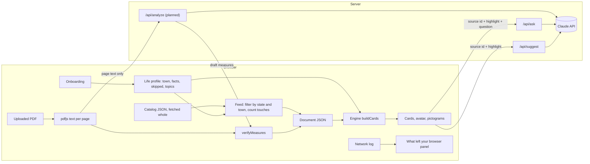

# Design Document

## Overview

Legible is a mostly client-side Next.js app. Documents are plain JSON in one shared format, listed in a public catalog. A short onboarding builds a life profile in the browser. The home feed fetches the whole catalog and filters it locally to the person's state and town. A pure engine combines any document with the profile and returns sorted cards. A reliability layer traces every sentence to a fingerprinted source. Server routes never receive the profile (the one exception is the opt-in fact phrases described under "Chat dock"):

- `POST /api/ask` answers a question about official text (a ballot question, a bill, or an official date) from that text only.
- `POST /api/suggest` proposes three questions about a highlighted official passage.
- `POST /api/analyze` (planned, task 9.3) will turn the page text of an uploaded PDF into draft measures.

Everything that makes the app trustworthy is ordinary deterministic code: the fixed vocabularies, the sorting rules, the quote verifier, and the banned-word lint. The model only drafts content that this code then checks.

## Architecture



Models: `/api/ask` and `/api/suggest` use `claude-sonnet-5`; build-time bill drafting (`npm run data:draft`) uses `claude-opus-5`. The analyze route and ingest below are planned with `claude-opus-5`.

All client requests go through one `apiFetch` wrapper that records each request's route and payload categories for the privacy panel. Profile state is never passed to that wrapper.

## Data model

```ts
// src/lib/vocab
type Direction = "expands" | "restricts" | "rule_change" | "who_decides" | "none";

type FactId =
  | "rents" | "owns" | "lives_with_family"
  | "registered_here" | "votes_in_primaries"
  | "public_defender_contact" | "state_employee"
  | "wants_single_family" | "buys_cannabis" | "owns_firearm"
  | "kids_in_schools" | "runs_business_here"    // added for town documents
  | "drives" | "rides_transit";                 // getting around

type TopicId =
  | "housing_costs" | "open_space" | "voting_access" | "elections"
  | "government_transparency" | "taxes" | "labor" | "criminal_justice"
  | "cannabis_policy" | "gun_policy" | "public_safety" | "local_control"
  | "schools" | "roads_transit";                 // added for town documents

// Onboarding asks ONBOARDING_FACTS, grouped into LIFE_AREAS; the same for every document.
// Every other fact is asked inline on the card that depends on it.

// src/lib/engine
interface Quote {
  id: string;
  text: string;           // verbatim
  page?: number;          // 1-indexed source page
  locator: string;        // "AG summary", "Article 4", ...
  status: "reviewed" | "verified" | "failed";
}

interface WhySentence { text: string; quoteId: string }   // every sentence cites a quote

interface Rule {
  fact: FactId;           // fact that must be true for this rule to fire
  direction: Direction;
  why: WhySentence[];     // at most 2
}

interface Measure {
  id: string;             // "ballot-2026-q7"
  number: string;         // "7", "Article 12"
  title: string;          // plain-English short title
  officialTitle: string;
  kind: "initiative" | "referendum" | "article" | "other";
  summary: Quote;
  outcomes: { yes?: Quote; no?: Quote; effect?: Quote };
  appliesToEveryone: boolean;
  everyoneDirection?: Direction;
  rules: Rule[];
  askFacts: FactId[];     // facts to ask inline when unanswered
  topics: TopicId[];
  quotes: Quote[];        // all quotes referenced by why sentences
  sourceUrl?: string;
  towns?: string[];       // Massachusetts municipalities named (uploads)
}

type TrustLevel = "reviewed" | "verified" | "ai_draft" | "flagged";

type DocType = "ballot" | "warrant" | "budget" | "hearing" | "agenda" | "other";

interface DecideBy {
  date: string;           // ISO date the decision is made or input closes
  who: string;            // "Voters", "Town Meeting", "City Council", "School Committee"
  how: "vote" | "meeting" | "comment";   // ballot vote, body votes at a meeting, public comment closes
}

interface DocumentData {
  id: string;
  title: string;
  place: { kind: "state" | "town"; name: string; townId?: string };
  docType: DocType;
  decideBy?: DecideBy;
  date?: string;
  source: { name: string; url?: string; hash?: string };  // hash: SHA-256 of the source PDF
  pagesHash?: string;     // SHA-256 of the page text snapshot the quotes were checked against
  provenance: "reviewed" | "verified" | "ai_draft";
  reviewedBy?: { name: string; date: string };
  measures: Measure[];
  flagged?: { measure: Measure; reasons: string[] }[];
  pages?: string[];       // page text, kept in memory for uploads only
}

// public/catalog/ma.json: the whole list is fetched; filtering happens in the browser.
interface CatalogEntry {
  id: string;
  title: string;
  place: { kind: "state" | "town"; name: string; townId?: string };
  docType: DocType;
  decideBy?: DecideBy;
  date?: string;
  trust: TrustLevel;
  url: string;            // document JSON, same origin
  askFacts: FactId[];     // union over measures, so the feed can list open questions before loading
  measureCount: number;
}

interface Profile {
  version: 1;
  townId?: string;
  facts: Partial<Record<FactId, boolean>>;   // only answered facts
  skipped: FactId[];                          // declined; ask at most once more, inside a card
  topics: TopicId[];
  source: "self" | "persona";                 // persona view is never written to storage
  updatedAt: string;
}

interface FeedEntry {
  entry: CatalogEntry;
  touches?: number;       // computed locally once the document JSON is loaded
  topTouching?: string;   // short title of the first touching measure, for the card preview
  openQuestions: FactId[];
  status: "upcoming" | "decided";   // from decideBy.date against the device clock
}

type Relevance = "touches" | "everyone" | "probably_not";

interface Card {
  measure: Measure;
  relevance: Relevance;
  onYourList: boolean;
  direction: Direction;
  why: WhySentence[];
  because: ({ kind: "fact"; id: FactId } | { kind: "topic"; id: TopicId })[];
  pendingQuestions: FactId[];
}
```

Each `FactId` and `TopicId` has a definition in `src/lib/vocab` with its plain question or label, its avatar part, and, for topics, a word list for typed matching.

## Ballot data

`data/questions.json` is machine-extracted and unreviewed. A conversion script produces `src/data/ballot-2026.json` in the `DocumentData` format. A person checks every quote against `data/official/IFV_2026_English.pdf` and sets `status: "reviewed"`; the app shows the reviewed label only when every quote in a measure is reviewed.

Draft rule table, to be reviewed in task 2:

| Q | Short title | Everyone | Facts asked | Topics |
|---|---|---|---|---|
| 1 | Public records for the Legislature and Governor | yes, who_decides | none | government_transparency |
| 2 | Public defender union | no | public_defender_contact, state_employee | labor, criminal_justice |
| 3 | Single all-candidate primary | yes, who_decides | votes_in_primaries | elections |
| 4 | Election Day registration | yes, rule_change | registered_here | voting_access |
| 5 | State revenue limit and rebate | yes, rule_change | none | taxes |
| 6 | Conservation fund | no | none | open_space |
| 7 | Single-family homes on 5,000 sq ft lots | no | rents, owns, wants_single_family | housing_costs, local_control |
| 8 | End retail adult-use marijuana | no | buys_cannabis | cannabis_policy |
| 9 | Keep the 2024 firearms law | no | owns_firearm | gun_policy, public_safety |

`registered_here` fires its rule when the answer is false.

## Engine

`buildCards(doc, profile): Card[]` is pure and synchronous.

1. For each measure, collect rules whose fact is true in the profile. If any fire, relevance is `touches`, direction comes from the first fired rule, and `why` comes from fired rules, capped at two sentences. Contradictory facts both fire and both appear in `because`.
2. Otherwise relevance is `everyone` if `appliesToEveryone`, else `probably_not`. With an empty profile, `why` uses a fixed sentence saying nothing in the answers is targeted.
3. `onYourList` is true when the measure's topics intersect the profile's topics; matching topics are added to `because`.
4. `pendingQuestions` lists `askFacts` the profile has not answered.
5. Sort key: touches, then on your list, then everyone, then probably not; ties by document order.

The engine never reads the network and never writes storage.

## Quote verification

`verifyMeasures(measures, pages)` in `src/lib/verify` runs on the server before the analyze response is returned, and again in the browser on receipt and when loading a pre-run sample.

- Normalize both sides: Unicode NFKC, curly quotes and dashes to ASCII, join words hyphenated across line breaks, collapse all whitespace to single spaces, trim.
- Look for the quote on its stated page. If it is missing, search all pages and correct the page. If still missing, mark the quote `failed`.
- A measure with any failed quote, or any generated string that fails the banned-word check, moves to `flagged` with its reasons.

## Analyze route

`POST /api/analyze` with `{ title: string, pages: string[] }`.

- Reject bodies above the limit: 150 pages or 400,000 characters. The browser checks the same limits first.
- Call `claude-opus-5` with streaming and the final-message helper, adaptive thinking, and `output_config.format` set to a JSON schema. Enums in the schema restrict `direction`, `fact`, and `topics` to the fixed vocabularies. Include server-side refusal fallbacks.
- The system prompt states that the document is untrusted data, that every quote must be copied exactly from the given page, that explanations use the fixed directions and avoid opinion words, and that the output describes effects without recommending a vote.
- Pages are sent tagged with their numbers so the model can return them.
- Run `verifyMeasures` and return `DocumentData` with `provenance: "ai_draft"`.
- Set a long `maxDuration` for this route. Never log page text beyond its length.

Request size stays far below Vercel's 4.5 MB body cap because only text is sent; the 2026 booklet's text is under 400 KB.

## Ask route

`POST /api/ask` with `{ documentId, measureId, question, quotes? }`.

- For the reviewed ballot, the server loads the measure from bundled JSON by id and ignores any client-provided text.
- For uploads, the client sends that measure's verified quotes, which are public text.
- Before any network call, the browser checks the question against a how-to-vote pattern and shows the fixed response locally.
- The model answers only from the provided quotes, cites a quote id for every sentence, and says when the text does not answer the question. Answers that fail the banned-word check are replaced with the fixed "the official text does not answer this" response.

## Draft a message

Pure template in the browser. Inputs are selected measure numbers and one factual question chosen from a short list. Output is at most 80 words, editable, with a Copy button. It never includes life facts or topics.

## UI components

- **Onboarding:** first run is hello and ZIP only. **ProfileSheet:** the avatar ring, the seven-item checklist, and one screen per life area and subjects, opened from the avatar.
- **TownPicker:** type-ahead over a bundled list of 351 municipalities with aliases.
- **Feed (Home):** header with avatar ring, one nudge, one timeline (name, due, what it is, how it reaches you), open questions, and a collapsed Decided group. **DocumentView:** a guide to one document: every question ranked for the person (or in ballot order), filter chips (All, May affect you, You follow, each topic), and per question a plain cited line, the direction pictogram, the official YES and NO statements side by side, the first sentence of the official fiscal statement as Cost, and an "If you rent"-style box with the matching why lines (or a plain note when nothing matches) plus the town effect. No polls and no arguments for a side (`src/lib/engine/ballot-guide.ts`).
- **ChatDock:** bottom-corner button and panel scoped to the open document or measure, citations on every sentence.
- **TrustPanel and ChainView:** per-document trust summary, and the sentence-to-source chain opened from "How do we know this?"
- **Ballot header:** avatar, document title, persona switcher, privacy panel button, "Remember on this device" and "Clear my information" (in the profile sheet)."
- **MeasureCard:** number, short title, relevance label, "On your list" label, direction pictogram with the avatar as the figure, why sentences, because chips, inline fact question, YES and NO quotes, quote badges, ask box.
- **Avatar:** SVG built from layered line-drawn parts keyed by facts and topics. No red or blue.
- **DirectionLegend:** the five pictograms with one-line meanings.
- **SourceView:** page text with the quoted sentence highlighted; opened from a quote badge.
- **UploadPanel:** file input, extraction status, size and scanned-PDF errors, progress with cancel, verified-quote counter, flagged list, sample fallback.
- **PrivacyPanel:** reads the `apiFetch` log and lists what was and was not sent.

Visual system lives in CSS custom properties in `src/app/globals.css`, exposed as Tailwind utilities: grey `background`, white `surface` cards, `surface-muted` pills, black `primary` pill, ink and grey text only. Palette sampled from the chosen reference: `accent` deep purple (touches you, meter), `info` lilac (on your list), `attention` terracotta (new, AI draft, flagged), `positive` sand (reviewed, verified), `ai` light purple (chat dock orb), plus `data-in` and `data-out` for budget charts. Each has a `-soft` tint for tags and its own `-foreground`: white on purple, ink on lilac, terracotta, and sand. All pairs meet 4.5:1. Radii `sm` 10 / `md` 14 / `lg` 20 / `xl` 32, one `shadow-card`, one easing curve (`ease-legible`, 400 ms), four type sizes, Figtree. Light and dark themes. Re-sorting animates card positions unless reduced motion is preferred.

## Onboarding

Two parts. **First run** is minimal: two screens, one answer, then the feed. **Fill in later** is where the life profile grows, pulled along by a completion ring around the avatar that the person sees every time they open Legible. The bet: people give more when they have already seen the feed and want it sharper, not before they know what the app does.

Pattern borrowed from Duolingo: one question per screen, a back arrow top left, Skip top right, one big button pinned to the bottom that stays grey until the answer is valid, and a friendly figure with a speech bubble. Mobile first at 375 px, one column, tap targets at least 48 px.

The figure is the Legible avatar (line-drawn, see Avatar). It gains one part per yes (a key for renting, a bus for transit). It never shows red or blue and never reflects a sensitive fact.

**No account, no sign-in.** Duolingo's "Create profile" exists to sync progress to a server. Legible's promise is that the profile never leaves the browser, so its counterpart is "Keep on this device." There is no email or password step anywhere, and no account. The optional profile name below is not an account. If cross-device use is wanted after the event, the candidate is an export code the person copies to another browser, not an account.

**Optional name, local only.** A person may enter a first name or nickname for their local profile (profile sheet), used only to greet and address the person within their own Legible interface, including the Home headline, Civic Profile, and header avatar. It adds nothing to sorting. Like every other profile field it stays in browser storage and is never sent to a server or any third-party service, including Supabase. Onboarding never asks for it. A name stored next to "owns a firearm" makes a shared or screenshotted device more identifying, so it stays optional and "Clear my information" removes it with the rest. Without a name, greetings use the town: "Here is what Somerville is deciding."

Onboarding belongs to the platform, not to any one document. Every screen is the same for every person, whatever is in their feed (a state ballot, a Town Meeting warrant, a school budget). No screen names a measure, a question number, or a document.

### First run

One question per screen with a progress bar and a percentage, Skip on every question, and the app's own buttons and option cards. It borrows the pacing of language-app onboarding without its look: no talking character, no speech bubbles, no chunky uppercase buttons. A **placeholder logo** (`Logo` in `FirstRun.tsx`, a purple rounded square with "L") stands in until the real mark exists.

| # | Screen | Copy | Controls |
|---|---|---|---|
| 0 | Welcome | Logo, "See what's being decided near you", the mission ("Legible makes public decisions understandable, personal, and easy to act on. It never tells you how to vote."), and three checks: N quick questions, about a minute; only your town is needed; answers stay in this browser. N is the length of the question list (4). | "Get started"; text button "Just show me everything" goes to Home with no town. |
| 1 | Where do you live? | "Question 1 of 4", the town field. | Thin progress bar with the percent (0%, 25%, 50%, 75%); "Continue" once a town is picked; "Skip". |
| 2–4 | Your home, your work, how you vote | "Question 2 of 4 · optional", "Which of these fits your home?", "Pick all that apply.", the same option cards as the profile sheet plus None of these. | "Continue" ("Finish" on the last), "Prefer not to say", "Skip" (records nothing), "Finish later". |
| 5 | Keep (only if something was answered and storage works) | Logo, "Keep your answers on this device?" | "Keep on this device", "Not now". The bar reads 100%. |

Who you live with, getting around, and subjects stay in the profile sheet. The feed opens with the ring at 14% (town only) and up to 57% if all three optional areas are answered.

### Fill in later: the avatar ring

The avatar sits in the feed header inside a thin ring that fills with the personalization meter (`personalization(p).percent`). The number sits under it in small type: "14%". It is visible on every visit and never animates on its own.

Tapping the avatar opens the **profile sheet**: a bottom sheet titled "Your profile" with the ring large at the top and a checklist of the seven meter items (town, the five life areas, subjects). Done items show a check and a one-line summary ("Rent · Ride transit"); open items show "Add". Each row opens the same one-question screen used everywhere:

| Screen | Copy | Controls |
|---|---|---|
| Life area (`LIFE_AREAS`) | Area heading, "Pick all that apply," and the area's `why` line. | One checkbox card per fact `statement`, a last card "None of these", text button "Prefer not to say", primary "Save". Valid once a card or "None of these" is picked. |
| Subjects | "Pick any subjects you follow." Under: "These add an On your list tag. They never change what touches you." | Topic chips plus a type-to-match box. "Save" sets `topicsConfirmedAt` even with none picked. |

After Save the sheet returns, the ring fills to its new value over 400 ms, the avatar gains its part, and the feed behind re-sorts. "Next: Getting around" appears as a text button so a person on a roll can keep going without returning to the list.

**Profile prompts live in "What matters to you?"** On Home, three categories (home, work, elections) ask for details with plain buttons and show "Added" with "Edit" once answered, so nothing is asked twice. The town is asked there only when missing. The rest of the profile opens from a link and from the avatar.

**Remember, asked at the right moment.** The ring only brings people back if the profile survives a refresh, but storage stays opt-in. So the first time a person saves anything beyond the town, the sheet shows one line under the ring: "Keep this on this device? It stays in this browser only. Clear my information erases it any time." with "Keep" and "Not now." Not now is not asked again that session.

At 100% the ring closes and the line under it reads "Your profile is filled in." No confetti, no streaks, no badge. Persona views hide the ring.

The five life areas, in order:

| Area | Statements |
|---|---|
| Your home | I rent my home · I own my home |
| Who you live with | I live with family · I have kids in the public schools |
| Your work | I work for the state · I run a business in town |
| Getting around | I drive · I ride the bus, train, or subway |
| Voting | I'm registered to vote at my current address · I usually vote in state primaries |

On Next, picked statements are recorded as yes and the area's other statements as no (`answerArea`). "None of these" records all as no. "Prefer not to say" settles every fact in the area for good (`declineArea`). Skip records each fact as skipped once.

Facts outside the life areas are never asked here: sensitive facts (`SENSITIVE_FACTS`) and narrow ones that only one kind of decision reads (`wants_single_family`). They are asked inside the card that depends on them, with the reason visible. Adding a fact to a life area is a vocab change, made when it describes everyday life broadly, not when one document needs it.

ZIP data: a bundled Massachusetts ZIP-to-town table (`src/data/zips.json`), built from the Census ZCTA to county subdivision relationship file. Lookup runs in the browser. Only `townId` is stored; the ZIP itself is discarded once the town is resolved.

Rules:

- "Prefer not to say" settles a fact for good (`declineFact`, skip count set to `MAX_SKIP_TIMES`). The Skip link skips for now: the fact may be asked once more on its card.
- Rent and own are separate statements. Both can be picked and the engine names both.
- Sensitive facts (`SENSITIVE_FACTS`) never appear here. They are asked inside the card that depends on them, with the reason visible.
- Every answer is written with its source (`{ kind: "onboarding" }`) and timestamp, so the UI can later say "you answered this during setup" on a because chip.
- A fact skipped here may be asked once more, inside a card. Declined there, it is never asked again (`MAX_SKIP_TIMES`).
- The profile sheet opens from the avatar, from any because chip, and from any avatar badge, landing on the relevant row.
- Persona profiles bypass onboarding entirely and are never written to storage.
- Copy never uses the banned words and never says "political." The phrase is "life profile."

## Personalization meter

A ring around the avatar with the percentage under it, shown in the feed header and large at the top of the profile sheet. It measures how much of the life profile is filled in. It does not depend on which documents are in the feed, and it never measures how much the person has disclosed. Logic: `src/lib/engine/personalization.ts`.

**What counts.** Seven items, one per onboarding screen that holds information, all weighted the same:

| Item | Done when |
|---|---|
| Town | `townId` is set (ZIP or town name) |
| Your home | rents and owns are each answered or declined |
| Who you live with | lives_with_family and kids_in_schools |
| Your work | state_employee and runs_business_here |
| Getting around | drives and rides_transit |
| Voting | registered_here and votes_in_primaries |
| Subjects you follow | at least one topic on, or Continue with none |

`percent = floor(done / 7 * 100)`, so 100 appears only when every item is done. First run ends at 14% (town only) to 57% (town and the three optional areas); each life area adds 14 or 15 points.

**Rules.**

- "Prefer not to say" counts as done. A plain Skip for now does not. Yes and No count the same.
- Facts asked inside cards (sensitive and narrow ones) are never counted. Those questions come with their own context; the meter never pushes anyone toward them.
- Not counted: the remember toggle (storage stays opt-in; the meter never nudges it), opened documents, chat use.
- Below 100%, the profile sheet lists what is left by life area, and the feed shows one nudge card for `nextItem(p)`.
- At 100%: "Your profile is filled in." No confetti, no streaks, no badge.
- Persona views hide the meter.
- Copy avoids the banned words.

## Information gathered

Everything Legible gathers, where it comes from, where it lives, and what it is for. Nothing in this table is ever sent to a server. The authoritative types are in `src/lib/engine/profile.ts`.

| Field | Gathered by | Stored | Used for |
|---|---|---|---|
| `name` | optional, typed in the profile sheet (first name or nickname, up to 40 characters) | profile | greeting and addressing the person in their own interface (Home headline, Civic Profile, header avatar); never sorting, never sent to a server or third party, including Supabase |
| `townId` | onboarding screen 1 (ZIP or town name, resolved locally; the ZIP is not kept), or feed header | profile | filtering the catalog in the browser; town context on cards later |
| `facts[id].value` | onboarding, a card, open questions, or an edit | profile | firing rules: "Touches you," direction, why sentences |
| `facts[id].source`, `.at` | set automatically with each answer | profile | explaining where an answer came from; tests for ask-once rules |
| `skipped[id].times`, `.source`, `.at` | set automatically on each skip | profile | never re-asking past the limit |
| `topics[id].via`, `.at` | onboarding screen 3 or a chip | profile | "On your list"; the typed text is never stored |
| `topicsConfirmedAt` | Save on the Subjects screen | profile | the personalization meter's topics item |
| `source` | set by the persona switcher | profile | keeping persona views out of storage |
| `createdAt`, `updatedAt` | automatic | profile | "Clear my information" confirmation, migrations |
| `preferences.remember` | profile sheet, the first time something beyond the town is saved, or header | preferences | whether anything is written to storage at all |
| `preferences.onboardingDone` | end of onboarding | preferences | skipping onboarding on return visits |
| `session.openedDocuments` | opening a document or expanding a card | memory, storage only if remember is on | restoring the view; feed ordering tiebreak |
| `session.dismissedOpenQuestions` | dismissing an open question on the feed | memory, storage only if remember is on | not nagging |
| `session.activePersonaId` | persona switcher | memory only | restoring the self profile when the persona view closes |

Never gathered: email, password, account, a name beyond the optional local `name` above, phone, age, party, income, address beyond the town, free text about the person, typed topic text, IP address, device fingerprint, analytics events. Reduced-motion comes from the operating system setting at render time and is not stored.

Derived, never stored: sorted cards, touch counts, avatar parts, because chips. All recomputed by `buildCards` whenever the profile changes.

Storage: one `localStorage` key, `legible.profile.v1` (a profile under the pre-rename key `nine.profile.v1` is moved to it once), holding `{ profile, preferences, session }` as JSON, written only when `remember` is on, read through `parseProfile`, which drops unknown ids and rejects other versions. "Clear my information" (profile sheet, after a confirm step) deletes the key and resets the in-memory profile. Storage access is wrapped in try/catch; if it throws, the remember toggle is disabled with a note and the app runs in memory.

## Home feed and catalog

**For you leads with the ballot (task 26).** The upcoming ballot is For you's main content, under the header: all its questions, ranked by `ballotPicks` (`src/lib/engine/ballot-picks.ts`). Questions an answer touches come first, then questions on a followed subject; ties go to a question that is both, then to more matching answers, then ballot order. Nothing is pinned: with no profile, nothing is put forward and all questions show in ballot order. The first put-forward question is the featured decision; the rest are rows; the others follow as compact rows with where each stands. Then Coming up, then "Also near you" (other decisions, without bills). Proposed bills sit on Explore in a "Proposed legislation" section; For you only counts the ones an answer or a followed subject connects to.

Home is a feed of decisions, not a ballot page. Each item is one document: the state ballot, a Town Meeting warrant, a school budget, a zoning hearing. The 2026 ballot is one item among them. Opening an item shows its measures as cards (the document view: Touches you, On your list, Applies to everyone).

### How the feed is fetched, privately

`public/catalog/ma.json` lists every document Legible has, for the whole state. The browser downloads the whole file through `apiFetch` (logged as "catalog, no profile data") and filters it locally: `place.kind === "state"` or `place.townId === profile.townId`. For each kept entry it loads the document JSON and runs `buildCards` locally to get `touches` and `topTouching`. The server never learns the town or any fact. Catalog and documents are static files, cacheable, and work offline after the first load.

### Civic items

Next to documents, the feed carries lighter **civic items**: election deadlines, voting windows, public meetings, and state bills (`src/lib/engine/civic.ts`, data in `src/data/civic-ma.json`). They have no measures. Each names its official source and how it was checked, shown on the card:

| Check | Meaning | Label |
|---|---|---|
| `quote` | Found word for word in an official PDF (election dates in the voter booklet) | "Found word for word, page 4" |
| `page` | A person read the official page on a date (bill status on malegislature.gov, council dates on cambridgema.gov) | "Checked against the official page on 2026-10-24" |
| `schedule` | Date follows the body's published standing schedule; no agenda posted yet | "Usual schedule: first and third Tuesday, 6 p.m. Check the posted agenda." |

An item touches the person when a profile fact matches one of its `touches` rules (the registration deadline touches `registered_here: false`; the school cellphone bill and School Committee meetings touch `kids_in_schools: true`). Election dates apply to everyone. Topics mark "On your list." `civicFeed` drops past items and orders touches, then followed topics, then everyone; within each, today, open windows, upcoming by date, then undated bills.

Civic items mix into the timeline with documents, by date. Meeting cards never list agenda items until a real posted agenda is ingested.

Source data: `data/legible_ma_seed.json` (the team's Supabase seed) is rebuilt by `npm run data:civic` through `scripts/civic-ma.content.ts`, which replaces news and advocacy sources with official ones, rewrites summaries neutrally, maps the seed's topics and circumstances onto Legible's vocab, and lists every seed item it leaves out with the reason (ballot questions duplicated by the reviewed ballot; bills without an official citation). The build fails if a booklet quote is not found, a source is not an official domain, a banned word appears, or a seed item is unaccounted for.

### Layout, top to bottom

The page leads with personal impact (task 26). Opened from For you, it lands at the top and opens with the same reason For you gave, so it reads as the recommendation continued. `ballotReason` (`src/lib/engine/ballot-picks.ts`) gives both screens the same words.

1. **Nav.** Back (48 px circle), share, open the official page.
2. **Header.** Kicker ("Massachusetts ballot · Question 4"), title in the editorial face, meta line ("AG summary · Voters decide Nov 3 · 2 min read"), and the short summary: the first overview line with its source line.
3. **1 How could this affect you?** Accent-soft when an answer touches the question, a raised surface otherwise. Groups split by hairlines, each holding only cited lines and left out when empty (`impactFor` in `measure-page.ts`):
   - **The reason**: "Why this matters to you: You rent." / "On your list: …" / "May apply to you: Applies if …". Left out for "applies to every voter" and no match, which Direct impact already says.
   - **Direct impact**: the card's own lines, only when an answer touches it; otherwise one plain line saying nothing in the answers points to a change. The inline fact question sits here when an unanswered fact decides relevance (never one already answered or declined twice), then **When it would reach you**.
   - **Possible indirect impact**: the `localReach` town line, then `PAGE_LINES.indirect` (official fiscal statement: budgets, local aid, revenue).
   - **What's uncertain**: `PAGE_LINES.uncertain`, only where the official text says something is not known (Q2, Q5, Q6, Q7).
   - **Based on what you told Legible**, then the trust summary.
4. **Next step.** One civic action from `nextSteps` (registration lookup).
5. **2 What would change?** The remaining overview lines, the direction, "Read the official summary" (verbatim, on demand), and the cost: first sentence of the fiscal statement, the rest on demand.
6. **3 What happens if YES or NO wins?** Official statements side by side, verbatim, a plain line under each, and "Legible explains both and never suggests a vote."
7. **4 How do we know?** One line on how lines were checked and the review state; "Show sources and checks" reveals the source, the page, what happens on a failed match, and the full law, word for word.
8. **5 Ask Kiro.** The measure's neutral starter questions, "Ask about your situation" (sharing offered, off until switched on), and a privacy line.
9. **Ask your legislator**, then **Related near you**.
10. **The way on.** "Next · Question N" (the next question in For you's order, `nextPick`) and "All your ballot questions" (For you, scrolled to the ballot).

### Evidence in place

Under every Legible sentence sits a source line: a check mark, the locator and page ("AG summary, page 12"), and "Show the words". Tapping it opens a surface-muted panel directly below the sentence with the quote in serif, the cited words marked with `accent-soft` and an accent underline, the status tag, and "How do we know this?". The person never leaves the page to check a claim. "How do we know this?" opens ChainView as a bottom sheet: sentence, quote, page (opens SourceView), official file with fingerprint, then two boxes kept apart: "Machine check: passed" and "Human review: pending" or reviewer and date.

### States

Touches you; applies to everyone; probably not for you (still shows what reaches the town); empty profile (overview sentence plus "Add your home" nudge); answer declined (no follow-up, "Legible won't ask again"); AI draft; referendum; offline (official link only). Flagged measures never get a page.

### Content this needs

New optional `Measure` fields, hand-authored in `scripts/ballot-2026.content.ts`, every sentence cited and linted:

- `outcomeLines?: { yes: WhySentence; no: WhySentence }` per rule, so personal lines exist for both outcomes;
- `takesEffect?: { label: string; why: WhySentence }` ("Jan 1 2028");
- `notAnswered?: string[]`: questions the official text leaves open, checked by a person against the booklet.

When a field is missing the row is left out; the page never fills it with generated text.

## Content pipeline

Nothing in the browser crawls the web. The team runs an ingest script that turns public documents into catalog entries, with the same model, schema, and quote verification as the analyze route.

**Sources.** `data/sources/ma.json` is a hand-curated list, one row per document: `{ id, townId?, docType, title, url, file?, decideBy, note? }`. URLs point to official PDFs on town, city, school, or state sites (clerk warrants, school committee budgets, planning board hearing notices). Curating the list is a person's job; Legible does not scrape arbitrary sites in this build.

Some city sites block scripts (newtonma.gov answers 403 behind Akamai). For those rows a person saves the PDF from a browser to `file` (under `data/sources/files/`), and ingest reads the file instead of downloading. `url` is still kept, because it is the citation shown to users.

**`npm run ingest`** (`scripts/ingest.ts`), for each source:

1. Read `file` if set, else download `url`. Record `source.hash` (SHA-256). Skip when the hash matches the last run.
2. Extract page text with `pdfjs-dist` (same code as uploads). Stop with a clear error on a scanned PDF, and report which pages had no text layer when only some do.
3. Draft measures with the shared analyze module (`src/lib/analyze`, used by both the route and this script): `claude-opus-5`, structured output, untrusted-document system prompt, fixed vocabularies.
4. Run `verifyMeasures`. Measures with a failed quote or a banned word go to `flagged` and are not shown. A document with zero verified measures is not listed.
5. Write `public/docs/<id>.json` with `provenance: "ai_draft"`, `pagesHash`, `docType`, and `decideBy`.
6. Regenerate `public/catalog/ma.json` from every file in `public/docs/` plus the bundled ballot.

**Review.** A person who checks a document's quotes against the PDF adds `data/reviews/<id>.json` with `reviewedBy`. The next ingest flips the document to reviewed. A changed source hash creates a new version and resets review.

**Schedule.** For the event, run once by hand before the demo for the chosen towns, and commit the output. Later, a daily scheduled CI job runs ingest and opens a pull request with the changes, so a person sees every new document before it ships.

**Demo towns.** Cambridge and Newton. Candidate sources are in `data/sources/ma.json`: Cambridge's Alexandria Technology Square zoning petition (Council must act by January 4, 2027), Newton's Land Use Committee public hearing (November 10, 2026), and Newton's Zoning & Planning Committee agenda (October 26, 2026).

## Reliability layer

Every app-authored sentence is a `WhySentence` with a `quoteId`. Every `Quote` has `page`, `locator`, and `status`. Every document carries `source.hash` and `pagesHash`. That is the chain: sentence, quote, page, fingerprinted source.

Trust levels and where they are set:

| Level | Set by | Shown as |
|---|---|---|
| reviewed | a person sets `reviewedBy` in the content file; build flips quote status | "Reviewed by name, date" |
| verified | build or runtime locates the quote word for word | "Found word for word, page N" |
| ai_draft | document came from the analyze route | "AI draft, quotes verified, not human reviewed" |
| flagged | a quote was not found or a string failed the word lint | hidden from cards, listed under "Flagged" |

Checkpoints: `npm run data:build` for shipped documents, `verifyMeasures` on the server then in the browser for uploads, and per-sentence citation checks on chat answers. `findBannedWords` runs at all three.

UI: a quote badge on every citation; "How do we know this?" on each card opening a chain view with sentence, quote, page, and source as four clickable rows; a TrustPanel per document showing verified out of total, reviewer and date, source hash, and link.

**Original text for every feed item.** An item appears only with its saved original, or with a plain statement that none exists yet. Every Home and Explore card has an "Official text" line (`OriginalLine`) that opens the item; the detail page shows the original in full.

| Item | Original | Where it comes from | Fingerprint |
|---|---|---|---|
| Ballot question | The full law (`Measure.fullText`: label and booklet page range, checked against each page's "Full Text" heading), plus the summary, YES/NO, and fiscal quotes | The official booklet PDF, served at `/official/IFV_2026_English.pdf`, opened at the page; page text loaded on demand | `source.hash` of the PDF, `pagesHash` of the page text, `savedOn` |
| Election date | The booklet sentence that sets it, verbatim | `CivicItem.original`, kind `booklet`, with the booklet page | the booklet PDF's hash |
| Bill | Full bill text, official description, and every action | `npm run data:bills` saves the Legislature API's record to `data/official/bills/`; the build publishes a reader copy and takes the latest action from the official history | SHA-256 of the saved snapshot, fetch date |
| Meeting | The posted agenda | A PDF saved as `data/official/agendas/<id>.pdf` | SHA-256 of the PDF |
| Meeting without an agenda | none: "No agenda is posted for this meeting yet" | — | — |

The civic build fails if any item has no original record.

## Chat dock

**One assistant: Ask Kiro** (`ChatDock.tsx`, Khanh's design, mounted by `ChatDockGate` in the layout). Everything that asks a question opens it; there is no second chat surface.

**Highlight to ask** (`HighlightMenu.tsx`, mounted in `LegibleApp`). Selecting text inside `[data-ask-official]` (the full law and bill text in the reader, the official summary, YES and NO statements, fiscal statement, and a booklet quote on a deadline) shows a small menu near the selection: **Explain this**, then two or three questions. Headings, Legible's own lines ("If you rent …"), controls, and any text outside official sections are ordinary selections. The menu sits below the selection on touch screens when it fits (clear of the native copy bar) and never covers the highlight; it closes on outside click, Escape, or scroll. Questions come from `/api/suggest` when a model is configured, else from `highlightQuestions` (whole-word patterns over the highlight).

**Context passed automatically** (`src/lib/ask/context.ts`, an `AskRequest` event). The page marks its source with `data-ask-*` attributes: kind (`ballot`, `bill`, `civic`), id, title, locator, page, and the official URL from Legible's data. Ask Kiro receives the source, the highlighted words, the mode, and the question, shows "Reading: Question 4 … · Full Text of Proposed Law, p.39" with the official link, and quotes the passage above the question. Follow-ups send the same source and passage plus up to four earlier turns. Highlighting a different document adds "Now asking about …" and starts a fresh context, so turns are never mixed; Clear does the same.

**Grounding on the server** (`src/lib/ask/ground.ts`). The route never trusts text from the browser: it finds the highlighted words in the official text it holds (the question's quotes, else the saved full law; the saved bill; the booklet quote) and adds about 700 characters around them, so Kiro can see who a rule applies to. Words not found are refused ("Kiro can only explain the official wording"). The prompt (`src/lib/ask/prompt.ts`) states what the document is (a proposed law, a law in effect on the ballot as a referendum, a bill that is not law, an official date), requires one cited quote per sentence, keeps "would" (what the text does) apart from "could" (possible effects), and says when the text does not settle a question (for example who pays a fine). Explain answers come in parts shown as headings: What it means, Why it matters, and, only if the person shared something, How it could affect you. Every answer is checked for known quotes, allowed parts, and banned words.

**Personal context is opt-in.** The dock offers only the answers that matched this item ("Use what I told Legible: you rent"), unchecked each time the document changes. Only those phrases are sent, checked server-side against Legible's own fact phrases. A line under each reply says exactly what was sent.

**No model configured.** `/api/ask` and `/api/suggest` answer 503: the menu keeps its rule-based questions, and Kiro says it isn't connected yet and shows the official passage and source instead of an explanation. The local how-to-vote check still runs first.

## Installable web app (PWA)

Legible can be added to a phone's home screen and opens in its own window, with no browser bar. It is the same website: same code, same deploy, same browser-only profile. Nothing new is sent, stored, or asked for.

**What ships.**
- `src/app/manifest.ts` (served as `/manifest.webmanifest`): name and short name Legible, `display: standalone`, `start_url` and `scope` `/`, background and theme colour the Notebook page colour.
- Icons: the Legible mark from `public/icons/legible-mark.svg` on the page colour, in `public/icons/icon-192.png`, `icon-512.png`, `icon-maskable-512.png` (mark kept inside the 80% safe zone), and `src/app/apple-icon.png` (180 px, opaque, for iOS). No new artwork.
- `src/app/layout.tsx`: `viewport` (`viewport-fit=cover`, theme colour per light and dark scheme from `src/lib/theme-color.ts`, zoom allowed) and `appleWebApp` (title Legible, default status bar, so the page starts below it).
- Mobile fixes, checked at 375 and 390 px: `overflow-x: clip` on the page so screen slide-ins never scroll sideways; body padding for the left and right safe-area insets (landscape notch); the onboarding footer and the "How do we know this?" sheet clear the home indicator (the profile sheet and the Kiro launcher already did); the Ask Kiro field is 16 px on phones, so iOS does not zoom in on focus, with a 44 px Ask button; the compact Details toggle on feed rows gets an invisible larger tap area on touch screens (`touch-target`), so a near miss does not open the row. Desktop is unchanged.

**Installing.**
- iPhone and iPad: open Legible in Safari, tap Share, then Add to Home Screen. (iOS 16.4 and later also offer this from the share menu in other browsers.)
- Android: open Legible in Chrome, open the menu, then Install app (or Add to Home screen). Some versions show an install banner.
- Desktop Chrome and Edge show an install icon in the address bar. Not needed for the election, but it works.

**What needs the internet.**
- Opening the app. There is no service worker, so a launch with no connection shows the browser's offline page rather than old information.
- Ask Kiro and the suggested questions on a highlight (`/api/ask`, `/api/suggest`).
- Official sources: the booklet PDF, bill pages, mass.gov and other links open from the network.

Once a page has loaded, everything Legible itself shows (the feed, ballot explanations, quotes and citations, the profile) runs in the browser and keeps working if the connection drops, as before. All of it comes from the deploy the page was loaded from; there are no separate live updates, so there is nothing that could be shown stale while looking current. Kiro already says when it is offline.

**Limitations of this first version.**
- No offline launch and no caching, on purpose (see above). If offline launch is added later, cached content must say when it was published and that it may be out of date.
- iOS keeps a home-screen app's storage apart from Safari's. A profile remembered in Safari does not carry into the installed app; the person sets it up once there. On Android, the installed app shares Chrome's storage for the site.
- Links shared from the app open in the browser, not in the installed app. External links (`target="_blank"`) open in the browser or its in-app view.
- No push notifications, badges, or background work.
- The install prompt cannot be triggered by the page on iOS; the person uses the Share menu.

**Toward Capacitor (not started).** This work is what a Capacitor wrapper would need from the web app anyway: icon sources at 512 px, the theme colours in one TypeScript file, safe-area handling under `viewport-fit=cover` (which native web views use), phone-sized form fields, and no service worker that could compete with bundled files. No server dependency was added. The remaining steps (a mobile-only static export, an API base URL with CORS on the two routes, native links, share, and back button) are in the Capacitor audit and wait for approval.

## Error handling

| Situation | Behavior |
|---|---|
| Scanned PDF or too little text | Explain that scanned documents are not supported. No request. |
| Document over size limit | Say so before sending. |
| Analyze timeout, error, or refusal | Show the error and offer the pre-run sample for known demo documents. |
| Some quotes fail verification | Hide those measures, list them as flagged, show the counter. |
| Ask route error | Show a retry and the measure's official text. |
| Official page link broken | Cached quote still renders; link marked unavailable. |
| Browser storage unavailable | Remember-on-device is disabled with a note; the app still works. |
| Catalog fetch fails | Feed shows the bundled 2026 ballot and says other documents are unavailable. |
| No town chosen | Feed shows state documents only, with a prompt to add a town. |
| Chat answer cites an unknown quote | Answer replaced by the fixed response; the event is logged in the privacy panel. |
| Offline after load | Sorting, avatar, persona switching, and drafting still work; ask and analyze show an offline message. |

## Testing strategy

- **Engine (Vitest):** the three personas produce distinct, expected card orders; empty profile; contradictory facts; topics without facts.
- **Verification (Vitest):** exact match, whitespace and hyphenation differences, wrong page corrected, paraphrase fails.
- **Lint (`npm run lint:words`):** scans app strings, `src/data`, and `public/demo` for banned words, excluding verbatim quote fields.
- **Data checks:** every why sentence references an existing quote; Question 9's YES text says the law stays in place.
- **Manual acceptance:** network tab shows no profile data; offline re-sort works; 375 px layout; keyboard pass; persona screenshots saved.

## Decisions this design depends on

- Built-in API citations are not used, because they cannot be combined with structured output. Quotes come back as JSON and the app verifies them.
- Uploads send extracted text rather than PDF bytes, to stay under the request size cap and so that verification uses exactly what the model saw.
- Documents enter the catalog through a curated source list and a team-run ingest script, not live crawling, so every document has a known official source and a person can see each one before it ships.
- No 3D map in this build. Town context is a stretch, as a sourced number or a flat map.
