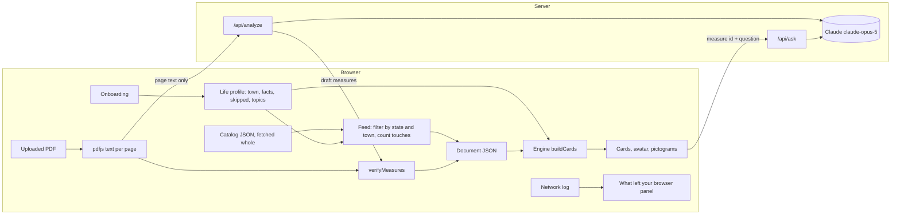

# Design Document

## Overview

Nine is a mostly client-side Next.js app. Documents are plain JSON in one shared format, listed in a public catalog. A short onboarding builds a life profile in the browser. The home feed fetches the whole catalog and filters it locally to the person's state and town. A pure engine combines any document with the profile and returns sorted cards. A reliability layer traces every sentence to a fingerprinted source. Only two server routes exist, and neither ever receives the profile:

- `POST /api/analyze` turns the page text of an uploaded PDF into draft measures.
- `POST /api/ask` answers a question about one measure from its official text.

Everything that makes the app trustworthy is ordinary deterministic code: the fixed vocabularies, the sorting rules, the quote verifier, and the banned-word lint. The model only drafts content that this code then checks.

## Architecture



All client requests go through one `apiFetch` wrapper that records each request's route and payload categories for the privacy panel. Profile state is never passed to that wrapper.

## Data model

```ts
// src/lib/vocab
type Direction = "expands" | "restricts" | "rule_change" | "who_decides" | "none";

type FactId =
  | "rents" | "owns" | "lives_with_family"
  | "registered_here" | "votes_in_primaries"
  | "public_defender_contact" | "state_employee"
  | "wants_single_family" | "buys_cannabis" | "owns_firearm"
  | "kids_in_schools" | "runs_business_here"    // added for town documents
  | "drives" | "rides_transit";                 // getting around

type TopicId =
  | "housing_costs" | "open_space" | "voting_access" | "elections"
  | "government_transparency" | "taxes" | "labor" | "criminal_justice"
  | "cannabis_policy" | "gun_policy" | "public_safety" | "local_control"
  | "schools" | "roads_transit";                 // added for town documents

// Onboarding asks ONBOARDING_FACTS, grouped into LIFE_AREAS; the same for every document.
// Every other fact is asked inline on the card that depends on it.

// src/lib/engine
interface Quote {
  id: string;
  text: string;           // verbatim
  page?: number;          // 1-indexed source page
  locator: string;        // "AG summary", "Article 4", ...
  status: "reviewed" | "verified" | "failed";
}

interface WhySentence { text: string; quoteId: string }   // every sentence cites a quote

interface Rule {
  fact: FactId;           // fact that must be true for this rule to fire
  direction: Direction;
  why: WhySentence[];     // at most 2
}

interface Measure {
  id: string;             // "ballot-2026-q7"
  number: string;         // "7", "Article 12"
  title: string;          // plain-English short title
  officialTitle: string;
  kind: "initiative" | "referendum" | "article" | "other";
  summary: Quote;
  outcomes: { yes?: Quote; no?: Quote; effect?: Quote };
  appliesToEveryone: boolean;
  everyoneDirection?: Direction;
  rules: Rule[];
  askFacts: FactId[];     // facts to ask inline when unanswered
  topics: TopicId[];
  quotes: Quote[];        // all quotes referenced by why sentences
  sourceUrl?: string;
  towns?: string[];       // Massachusetts municipalities named (uploads)
}

type TrustLevel = "reviewed" | "verified" | "ai_draft" | "flagged";

type DocType = "ballot" | "warrant" | "budget" | "hearing" | "agenda" | "other";

interface DecideBy {
  date: string;           // ISO date the decision is made or input closes
  who: string;            // "Voters", "Town Meeting", "City Council", "School Committee"
  how: "vote" | "meeting" | "comment";   // ballot vote, body votes at a meeting, public comment closes
}

interface DocumentData {
  id: string;
  title: string;
  place: { kind: "state" | "town"; name: string; townId?: string };
  docType: DocType;
  decideBy?: DecideBy;
  date?: string;
  source: { name: string; url?: string; hash?: string };  // hash: SHA-256 of the source PDF
  pagesHash?: string;     // SHA-256 of the page text snapshot the quotes were checked against
  provenance: "reviewed" | "verified" | "ai_draft";
  reviewedBy?: { name: string; date: string };
  measures: Measure[];
  flagged?: { measure: Measure; reasons: string[] }[];
  pages?: string[];       // page text, kept in memory for uploads only
}

// public/catalog/ma.json: the whole list is fetched; filtering happens in the browser.
interface CatalogEntry {
  id: string;
  title: string;
  place: { kind: "state" | "town"; name: string; townId?: string };
  docType: DocType;
  decideBy?: DecideBy;
  date?: string;
  trust: TrustLevel;
  url: string;            // document JSON, same origin
  askFacts: FactId[];     // union over measures, so the feed can list open questions before loading
  measureCount: number;
}

interface Profile {
  version: 1;
  townId?: string;
  facts: Partial<Record<FactId, boolean>>;   // only answered facts
  skipped: FactId[];                          // declined; ask at most once more, inside a card
  topics: TopicId[];
  source: "self" | "persona";                 // persona view is never written to storage
  updatedAt: string;
}

interface FeedEntry {
  entry: CatalogEntry;
  touches?: number;       // computed locally once the document JSON is loaded
  topTouching?: string;   // short title of the first touching measure, for the card preview
  openQuestions: FactId[];
  status: "upcoming" | "decided";   // from decideBy.date against the device clock
}

type Relevance = "touches" | "everyone" | "probably_not";

interface Card {
  measure: Measure;
  relevance: Relevance;
  onYourList: boolean;
  direction: Direction;
  why: WhySentence[];
  because: ({ kind: "fact"; id: FactId } | { kind: "topic"; id: TopicId })[];
  pendingQuestions: FactId[];
}
```

Each `FactId` and `TopicId` has a definition in `src/lib/vocab` with its plain question or label, its avatar part, and, for topics, a word list for typed matching.

## Ballot data

`data/questions.json` is machine-extracted and unreviewed. A conversion script produces `src/data/ballot-2026.json` in the `DocumentData` format. A person checks every quote against `data/official/IFV_2026_English.pdf` and sets `status: "reviewed"`; the app shows the reviewed label only when every quote in a measure is reviewed.

Draft rule table, to be reviewed in task 2:

| Q | Short title | Everyone | Facts asked | Topics |
|---|---|---|---|---|
| 1 | Public records for the Legislature and Governor | yes, who_decides | none | government_transparency |
| 2 | Public defender union | no | public_defender_contact, state_employee | labor, criminal_justice |
| 3 | Single all-candidate primary | yes, who_decides | votes_in_primaries | elections |
| 4 | Election Day registration | yes, rule_change | registered_here | voting_access |
| 5 | State revenue limit and rebate | yes, rule_change | none | taxes |
| 6 | Conservation fund | no | none | open_space |
| 7 | Single-family homes on 5,000 sq ft lots | no | rents, owns, wants_single_family | housing_costs, local_control |
| 8 | End retail adult-use marijuana | no | buys_cannabis | cannabis_policy |
| 9 | Keep the 2024 firearms law | no | owns_firearm | gun_policy, public_safety |

`registered_here` fires its rule when the answer is false.

## Engine

`buildCards(doc, profile): Card[]` is pure and synchronous.

1. For each measure, collect rules whose fact is true in the profile. If any fire, relevance is `touches`, direction comes from the first fired rule, and `why` comes from fired rules, capped at two sentences. Contradictory facts both fire and both appear in `because`.
2. Otherwise relevance is `everyone` if `appliesToEveryone`, else `probably_not`. With an empty profile, `why` uses a fixed sentence saying nothing in the answers is targeted.
3. `onYourList` is true when the measure's topics intersect the profile's topics; matching topics are added to `because`.
4. `pendingQuestions` lists `askFacts` the profile has not answered.
5. Sort key: touches, then on your list, then everyone, then probably not; ties by document order.

The engine never reads the network and never writes storage.

## Quote verification

`verifyMeasures(measures, pages)` in `src/lib/verify` runs on the server before the analyze response is returned, and again in the browser on receipt and when loading a pre-run sample.

- Normalize both sides: Unicode NFKC, curly quotes and dashes to ASCII, join words hyphenated across line breaks, collapse all whitespace to single spaces, trim.
- Look for the quote on its stated page. If it is missing, search all pages and correct the page. If still missing, mark the quote `failed`.
- A measure with any failed quote, or any generated string that fails the banned-word check, moves to `flagged` with its reasons.

## Analyze route

`POST /api/analyze` with `{ title: string, pages: string[] }`.

- Reject bodies above the limit: 150 pages or 400,000 characters. The browser checks the same limits first.
- Call `claude-opus-5` with streaming and the final-message helper, adaptive thinking, and `output_config.format` set to a JSON schema. Enums in the schema restrict `direction`, `fact`, and `topics` to the fixed vocabularies. Include server-side refusal fallbacks.
- The system prompt states that the document is untrusted data, that every quote must be copied exactly from the given page, that explanations use the fixed directions and avoid opinion words, and that the output describes effects without recommending a vote.
- Pages are sent tagged with their numbers so the model can return them.
- Run `verifyMeasures` and return `DocumentData` with `provenance: "ai_draft"`.
- Set a long `maxDuration` for this route. Never log page text beyond its length.

Request size stays far below Vercel's 4.5 MB body cap because only text is sent; the 2026 booklet's text is under 400 KB.

## Ask route

`POST /api/ask` with `{ documentId, measureId, question, quotes? }`.

- For the reviewed ballot, the server loads the measure from bundled JSON by id and ignores any client-provided text.
- For uploads, the client sends that measure's verified quotes, which are public text.
- Before any network call, the browser checks the question against a how-to-vote pattern and shows the fixed response locally.
- The model answers only from the provided quotes, cites a quote id for every sentence, and says when the text does not answer the question. Answers that fail the banned-word check are replaced with the fixed "the official text does not answer this" response.

## Draft a message

Pure template in the browser. Inputs are selected measure numbers and one factual question chosen from a short list. Output is at most 80 words, editable, with a Copy button. It never includes life facts or topics.

## UI components

- **Onboarding:** first run is hello and ZIP only. **ProfileSheet:** the avatar ring, the seven-item checklist, and one screen per life area and subjects, opened from the avatar.
- **TownPicker:** type-ahead over a bundled list of 351 municipalities with aliases.
- **Feed (Home):** header with avatar ring, one nudge, Up next card, scope switch, decision cards with place, type, decide-by line, touches, preview, and trust, open questions, and a collapsed Decided group. **DocumentView:** one document's measures as cards.
- **ChatDock:** bottom-corner button and panel scoped to the open document or measure, citations on every sentence.
- **TrustPanel and ChainView:** per-document trust summary, and the sentence-to-source chain opened from "How do we know this?"
- **Ballot header:** avatar, document title, persona switcher, privacy panel button, "Remember on this device" and "Forget me."
- **MeasureCard:** number, short title, relevance label, "On your list" label, direction pictogram with the avatar as the figure, why sentences, because chips, inline fact question, YES and NO quotes, quote badges, ask box.
- **Avatar:** SVG built from layered line-drawn parts keyed by facts and topics. No red or blue.
- **DirectionLegend:** the five pictograms with one-line meanings.
- **SourceView:** page text with the quoted sentence highlighted; opened from a quote badge.
- **UploadPanel:** file input, extraction status, size and scanned-PDF errors, progress with cancel, verified-quote counter, flagged list, sample fallback.
- **PrivacyPanel:** reads the `apiFetch` log and lists what was and was not sent.

Visual system lives in CSS custom properties in `src/app/globals.css`, exposed as Tailwind utilities: grey `background`, white `surface` cards, `surface-muted` pills, black `primary` pill, ink and grey text only. Palette sampled from the chosen reference: `accent` violet (touches you, meter, feature card), `info` periwinkle (on your list), `attention` coral (new, AI draft, flagged), `positive` green (reviewed, verified), `ai` magenta (chat dock orb), plus `data-in` and `data-out` for budget charts. Each has a `-soft` tint for tags with ink text; strong fills take `on-strong` text. All pairs meet 4.5:1. Radii `sm` 10 / `md` 14 / `lg` 20 / `xl` 32, one `shadow-card`, one easing curve (`ease-nine`, 400 ms), four type sizes, Figtree. Light and dark themes. Re-sorting animates card positions unless reduced motion is preferred.

## Onboarding

Two parts. **First run** is minimal: two screens, one answer, then the feed. **Fill in later** is where the life profile grows, pulled along by a completion ring around the avatar that the person sees every time they open Nine. The bet: people give more when they have already seen the feed and want it sharper, not before they know what the app does.

Pattern borrowed from Duolingo: one question per screen, a back arrow top left, Skip top right, one big button pinned to the bottom that stays grey until the answer is valid, and a friendly figure with a speech bubble. Mobile first at 375 px, one column, tap targets at least 48 px.

The figure is the Nine avatar (line-drawn, see Avatar). It gains one part per yes (a key for renting, a bus for transit). It never shows red or blue and never reflects a sensitive fact.

**No account, no sign-in.** Duolingo's "Create profile" exists to sync progress to a server. Nine's promise is that the profile never leaves the browser, so its counterpart is "Keep on this device." There is no name, email, or password step anywhere. If cross-device use is wanted after the event, the candidate is an export code the person copies to another browser, not an account.

**No name.** A name adds nothing to sorting, and a name stored next to "owns a firearm" turns a shared or screenshotted device into an identifying record. Greetings use the town instead: "Here is what Somerville is deciding."

Onboarding belongs to the platform, not to any one document. Every screen is the same for every person, whatever is in their feed (a state ballot, a Town Meeting warrant, a school budget). No screen names a measure, a question number, or a document.

### First run

| # | Screen | Copy | Controls |
|---|---|---|---|
| 0 | Hello | Avatar with bubble: "Your town and state decide things every year that reach your daily life. Let's find the ones that touch you." | Primary "Get started". Text button "Just show me everything" goes to the feed with no town. |
| 1 | ZIP | "What's your ZIP code?" Under the field: "Stays in your browser." | Numeric field, 5 digits. A valid Massachusetts ZIP shows a check and the town name; a ZIP that spans towns shows those towns as chips. Link "Type your town instead" opens the TownPicker. Primary "Show my decisions" goes straight to the feed. |

That is all. No progress bar (two screens do not need one), no life facts, no topics, no remember screen. The feed opens with the avatar ring at 14% (town only) and the feed already filtered to the person's town and state.

### Fill in later: the avatar ring

The avatar sits in the feed header inside a thin ring that fills with the personalization meter (`personalization(p).percent`). The number sits under it in small type: "14%". It is visible on every visit and never animates on its own.

Tapping the avatar opens the **profile sheet**: a bottom sheet titled "Your profile" with the ring large at the top and a checklist of the seven meter items (town, the five life areas, subjects). Done items show a check and a one-line summary ("Rent · Ride transit"); open items show "Add". Each row opens the same one-question screen used everywhere:

| Screen | Copy | Controls |
|---|---|---|
| Life area (`LIFE_AREAS`) | Area heading, "Pick all that apply," and the area's `why` line. | One checkbox card per fact `statement`, a last card "None of these", text button "Prefer not to say", primary "Save". Valid once a card or "None of these" is picked. |
| Subjects | "Pick any subjects you follow." Under: "These add an On your list tag. They never change what touches you." | Topic chips plus a type-to-match box. "Save" sets `topicsConfirmedAt` even with none picked. |

After Save the sheet returns, the ring fills to its new value over 400 ms, the avatar gains its part, and the feed behind re-sorts. "Next: Getting around" appears as a text button so a person on a roll can keep going without returning to the list.

**One nudge in the feed.** Below 100%, the feed shows a single dismissible card above the documents for the first open item (`nextItem(p)`): "Add your home to sort decisions about zoning, rent, and property tax." It uses the area's `why` line, never a document name. Dismissing hides it for the session; it never shows two at once and never returns the same day once dismissed if remember is on.

**Remember, asked at the right moment.** The ring only brings people back if the profile survives a refresh, but storage stays opt-in. So the first time a person saves anything beyond the town, the sheet shows one line under the ring: "Keep this on this device? It stays in this browser only. Forget me erases it any time." with "Keep" and "Not now." Not now is not asked again that session.

At 100% the ring closes and the line under it reads "Your profile is filled in." No confetti, no streaks, no badge. Persona views hide the ring.

The five life areas, in order:

| Area | Statements |
|---|---|
| Your home | I rent my home · I own my home |
| Who you live with | I live with family · I have kids in the public schools |
| Your work | I work for the state · I run a business in town |
| Getting around | I drive · I ride the bus, train, or subway |
| Voting | I'm registered to vote at my current address · I usually vote in state primaries |

On Next, picked statements are recorded as yes and the area's other statements as no (`answerArea`). "None of these" records all as no. "Prefer not to say" settles every fact in the area for good (`declineArea`). Skip records each fact as skipped once.

Facts outside the life areas are never asked here: sensitive facts (`SENSITIVE_FACTS`) and narrow ones that only one kind of decision reads (`wants_single_family`). They are asked inside the card that depends on them, with the reason visible. Adding a fact to a life area is a vocab change, made when it describes everyday life broadly, not when one document needs it.

ZIP data: a bundled Massachusetts ZIP-to-town table (`src/data/zips.json`), built from the Census ZCTA to county subdivision relationship file. Lookup runs in the browser. Only `townId` is stored; the ZIP itself is discarded once the town is resolved.

Rules:

- "Prefer not to say" settles a fact for good (`declineFact`, skip count set to `MAX_SKIP_TIMES`). The Skip link skips for now: the fact may be asked once more on its card.
- Rent and own are separate statements. Both can be picked and the engine names both.
- Sensitive facts (`SENSITIVE_FACTS`) never appear here. They are asked inside the card that depends on them, with the reason visible.
- Every answer is written with its source (`{ kind: "onboarding" }`) and timestamp, so the UI can later say "you answered this during setup" on a because chip.
- A fact skipped here may be asked once more, inside a card. Declined there, it is never asked again (`MAX_SKIP_TIMES`).
- The profile sheet opens from the avatar, from any because chip, and from any avatar badge, landing on the relevant row.
- Persona profiles bypass onboarding entirely and are never written to storage.
- Copy never uses the banned words and never says "political." The phrase is "life profile."

## Personalization meter

A ring around the avatar with the percentage under it, shown in the feed header and large at the top of the profile sheet. It measures how much of the life profile is filled in. It does not depend on which documents are in the feed, and it never measures how much the person has disclosed. Logic: `src/lib/engine/personalization.ts`.

**What counts.** Seven items, one per onboarding screen that holds information, all weighted the same:

| Item | Done when |
|---|---|
| Town | `townId` is set (ZIP or town name) |
| Your home | rents and owns are each answered or declined |
| Who you live with | lives_with_family and kids_in_schools |
| Your work | state_employee and runs_business_here |
| Getting around | drives and rides_transit |
| Voting | registered_here and votes_in_primaries |
| Subjects you follow | at least one topic on, or Continue with none |

`percent = floor(done / 7 * 100)`, so 100 appears only when every item is done. First run ends at 14% (town); each life area adds 14 or 15 points.

**Rules.**

- "Prefer not to say" counts as done. A plain Skip for now does not. Yes and No count the same.
- Facts asked inside cards (sensitive and narrow ones) are never counted. Those questions come with their own context; the meter never pushes anyone toward them.
- Not counted: the remember toggle (storage stays opt-in; the meter never nudges it), opened documents, chat use.
- Below 100%, the profile sheet lists what is left by life area, and the feed shows one nudge card for `nextItem(p)`.
- At 100%: "Your profile is filled in." No confetti, no streaks, no badge.
- Persona views hide the meter.
- Copy avoids the banned words.

## Information gathered

Everything Nine gathers, where it comes from, where it lives, and what it is for. Nothing in this table is ever sent to a server. The authoritative types are in `src/lib/engine/profile.ts`.

| Field | Gathered by | Stored | Used for |
|---|---|---|---|
| `townId` | onboarding screen 1 (ZIP or town name, resolved locally; the ZIP is not kept), or feed header | profile | filtering the catalog in the browser; town context on cards later |
| `facts[id].value` | onboarding, a card, open questions, or an edit | profile | firing rules: "Touches you," direction, why sentences |
| `facts[id].source`, `.at` | set automatically with each answer | profile | explaining where an answer came from; tests for ask-once rules |
| `skipped[id].times`, `.source`, `.at` | set automatically on each skip | profile | never re-asking past the limit |
| `topics[id].via`, `.at` | onboarding screen 3 or a chip | profile | "On your list"; the typed text is never stored |
| `topicsConfirmedAt` | Save on the Subjects screen | profile | the personalization meter's topics item |
| `source` | set by the persona switcher | profile | keeping persona views out of storage |
| `createdAt`, `updatedAt` | automatic | profile | "Forget me" confirmation, migrations |
| `preferences.remember` | profile sheet, the first time something beyond the town is saved, or header | preferences | whether anything is written to storage at all |
| `preferences.onboardingDone` | end of onboarding | preferences | skipping onboarding on return visits |
| `session.openedDocuments` | opening a document or expanding a card | memory, storage only if remember is on | restoring the view; feed ordering tiebreak |
| `session.dismissedOpenQuestions` | dismissing an open question on the feed | memory, storage only if remember is on | not nagging |
| `session.activePersonaId` | persona switcher | memory only | restoring the self profile when the persona view closes |

Never gathered: name, email, password, account, phone, age, party, income, address beyond the town, free text about the person, typed topic text, IP address, device fingerprint, analytics events. Reduced-motion comes from the operating system setting at render time and is not stored.

Derived, never stored: sorted cards, touch counts, avatar parts, because chips. All recomputed by `buildCards` whenever the profile changes.

Storage: one `localStorage` key, `nine.profile.v1`, holding `{ profile, preferences, session }` as JSON, written only when `remember` is on, read through `parseProfile`, which drops unknown ids and rejects other versions. "Forget me" deletes the key and resets the in-memory profile. Storage access is wrapped in try/catch; if it throws, the remember toggle is disabled with a note and the app runs in memory.

## Home feed and catalog

Home is a feed of decisions, not a ballot page. Each item is one document: the state ballot, a Town Meeting warrant, a school budget, a zoning hearing. The 2026 ballot is one item among them. Opening an item shows its measures as cards (the document view: Touches you, On your list, Applies to everyone).

### How the feed is fetched, privately

`public/catalog/ma.json` lists every document Nine has, for the whole state. The browser downloads the whole file through `apiFetch` (logged as "catalog, no profile data") and filters it locally: `place.kind === "state"` or `place.townId === profile.townId`. For each kept entry it loads the document JSON and runs `buildCards` locally to get `touches` and `topTouching`. The server never learns the town or any fact. Catalog and documents are static files, cacheable, and work offline after the first load.

### Layout, top to bottom

1. **Header.** Town name ("Somerville") and "What is being decided near you"; the avatar with its completion ring on the right.
2. **Nudge.** At most one card, for `nextItem(profile)` (see Onboarding).
3. **Up next.** One large violet card for the most pressing upcoming item: the soonest `decideBy` among items with touches, else the soonest overall. It shows the title, "Town Meeting votes in 12 days", "3 of 14 articles touch you", and the first touching title. Tap opens the document.
4. **Scope switch.** Black-pill segmented control: All, State, and the town name.
5. **Feed list.** One card per item:
   - place tag (State, or the town) and document type ("Warrant", "Budget", "Ballot");
   - title;
   - decide-by line built from `decideBy`: "Voters decide Nov 3", "Town Meeting votes May 4", "Comments close Feb 10";
   - the local touches line, "3 of 14 touch you" in an accent-soft tag, or "Nothing in your answers points here yet" in grey;
   - preview "Including: Single-family homes on smaller lots" from `topTouching`;
   - trust label (Reviewed, Verified, AI draft).
6. **Open questions for you.** Facts that feed documents ask and the profile has not settled, as the same Pick-all screens, generic copy only. Answering re-runs `buildCards` for every loaded document.
7. **Decided.** Items whose `decideBy.date` has passed, collapsed by default, kept for reference with "Decided May 4".

**Order.** Upcoming before decided. Within upcoming: items with touches first, then soonest `decideBy`, then newest date. Items without `decideBy` sort after dated ones.

**Empty town.** When the catalog has nothing for the town: "Nine does not have documents for Somerville yet." with "Upload a town document" (opens the upload panel) and a line naming the kinds that help: warrants, budgets, hearing notices. State items still show.

**Uploaded documents** join the feed in memory, tagged with the profile's town and labeled AI draft, until the page is closed.

Copy rule: the feed heading is "Where your life meets what is being decided." Never "what you ought to care about." Deadlines are stated as facts ("Town Meeting votes May 4"), never as urgency ("Act now").

## Content pipeline

Nothing in the browser crawls the web. The team runs an ingest script that turns public documents into catalog entries, with the same model, schema, and quote verification as the analyze route.

**Sources.** `data/sources/ma.json` is a hand-curated list, one row per document: `{ id, townId?, docType, url, decideBy, title }`. URLs point to official PDFs on town, city, school, or state sites (clerk warrants, school committee budgets, planning board hearing notices). Curating the list is a person's job; Nine does not scrape arbitrary sites in this build.

**`npm run ingest`** (`scripts/ingest.ts`), for each source:

1. Download the PDF, record `source.hash` (SHA-256). Skip when the hash matches the last run.
2. Extract page text with `pdfjs-dist` (same code as uploads). Stop with a clear error on a scanned PDF.
3. Draft measures with the shared analyze module (`src/lib/analyze`, used by both the route and this script): `claude-opus-5`, structured output, untrusted-document system prompt, fixed vocabularies.
4. Run `verifyMeasures`. Measures with a failed quote or a banned word go to `flagged` and are not shown. A document with zero verified measures is not listed.
5. Write `public/docs/<id>.json` with `provenance: "ai_draft"`, `pagesHash`, `docType`, and `decideBy`.
6. Regenerate `public/catalog/ma.json` from every file in `public/docs/` plus the bundled ballot.

**Review.** A person who checks a document's quotes against the PDF adds `data/reviews/<id>.json` with `reviewedBy`. The next ingest flips the document to reviewed. A changed source hash creates a new version and resets review.

**Schedule.** For the event, run once by hand before the demo for the chosen towns, and commit the output. Later, a daily scheduled CI job runs ingest and opens a pull request with the changes, so a person sees every new document before it ships.

**Demo towns.** To be chosen by the team: two or three towns with a recent text PDF (a warrant or budget) and an upcoming date. Open item.

## Reliability layer

Every app-authored sentence is a `WhySentence` with a `quoteId`. Every `Quote` has `page`, `locator`, and `status`. Every document carries `source.hash` and `pagesHash`. That is the chain: sentence, quote, page, fingerprinted source.

Trust levels and where they are set:

| Level | Set by | Shown as |
|---|---|---|
| reviewed | a person sets `reviewedBy` in the content file; build flips quote status | "Reviewed by name, date" |
| verified | build or runtime locates the quote word for word | "Found word for word, page N" |
| ai_draft | document came from the analyze route | "AI draft, quotes verified, not human reviewed" |
| flagged | a quote was not found or a string failed the word lint | hidden from cards, listed under "Flagged" |

Checkpoints: `npm run data:build` for shipped documents, `verifyMeasures` on the server then in the browser for uploads, and per-sentence citation checks on chat answers. `findBannedWords` runs at all three.

UI: a quote badge on every citation; "How do we know this?" on each card opening a chain view with sentence, quote, page, and source as four clickable rows; a TrustPanel per document showing verified out of total, reviewer and date, source hash, and link.

## Chat dock

A ChatDock component mounts in the app layout, bottom right. It reads the current document id and, when a card is expanded, the measure id. Messages go to `/api/ask` with `{ documentId, measureId?, question, quotes? }` through `apiFetch`. Answers arrive as `{ sentences: { text, quoteId }[] }`; the browser checks each `quoteId` against the document's quotes and falls back to the fixed response on any miss or banned word. Each sentence renders with a quote badge that opens SourceView. Under each answer, a chip reads "Sent: document id, your question." The local how-to-vote check runs before any request. Three suggested questions per measure come from a small list in the content file. Offline, the dock shows a notice and the card's official text link.

## Error handling

| Situation | Behavior |
|---|---|
| Scanned PDF or too little text | Explain that scanned documents are not supported. No request. |
| Document over size limit | Say so before sending. |
| Analyze timeout, error, or refusal | Show the error and offer the pre-run sample for known demo documents. |
| Some quotes fail verification | Hide those measures, list them as flagged, show the counter. |
| Ask route error | Show a retry and the measure's official text. |
| Official page link broken | Cached quote still renders; link marked unavailable. |
| Browser storage unavailable | Remember-on-device is disabled with a note; the app still works. |
| Catalog fetch fails | Feed shows the bundled 2026 ballot and says other documents are unavailable. |
| No town chosen | Feed shows state documents only, with a prompt to add a town. |
| Chat answer cites an unknown quote | Answer replaced by the fixed response; the event is logged in the privacy panel. |
| Offline after load | Sorting, avatar, persona switching, and drafting still work; ask and analyze show an offline message. |

## Testing strategy

- **Engine (Vitest):** the three personas produce distinct, expected card orders; empty profile; contradictory facts; topics without facts.
- **Verification (Vitest):** exact match, whitespace and hyphenation differences, wrong page corrected, paraphrase fails.
- **Lint (`npm run lint:words`):** scans app strings, `src/data`, and `public/demo` for banned words, excluding verbatim quote fields.
- **Data checks:** every why sentence references an existing quote; Question 9's YES text says the law stays in place.
- **Manual acceptance:** network tab shows no profile data; offline re-sort works; 375 px layout; keyboard pass; persona screenshots saved.

## Decisions this design depends on

- Built-in API citations are not used, because they cannot be combined with structured output. Quotes come back as JSON and the app verifies them.
- Uploads send extracted text rather than PDF bytes, to stay under the request size cap and so that verification uses exactly what the model saw.
- Documents enter the catalog through a curated source list and a team-run ingest script, not live crawling, so every document has a known official source and a person can see each one before it ships.
- No 3D map in this build. Town context is a stretch, as a sourced number or a flat map.
