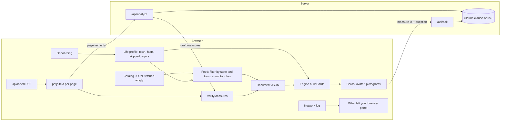

# Design Document

## Overview

Nine is a mostly client-side Next.js app. Documents are plain JSON in one shared format, listed in a public catalog. A short onboarding builds a life profile in the browser. The home feed fetches the whole catalog and filters it locally to the person's state and town. A pure engine combines any document with the profile and returns sorted cards. A reliability layer traces every sentence to a fingerprinted source. Only two server routes exist, and neither ever receives the profile:

- `POST /api/analyze` turns the page text of an uploaded PDF into draft measures.
- `POST /api/ask` answers a question about one measure from its official text.

Everything that makes the app trustworthy is ordinary deterministic code: the fixed vocabularies, the sorting rules, the quote verifier, and the banned-word lint. The model only drafts content that this code then checks.

## Architecture



All client requests go through one `apiFetch` wrapper that records each request's route and payload categories for the privacy panel. Profile state is never passed to that wrapper.

## Data model

```ts
// src/lib/vocab
type Direction = "expands" | "restricts" | "rule_change" | "who_decides" | "none";

type FactId =
  | "rents" | "owns" | "lives_with_family"
  | "registered_here" | "votes_in_primaries"
  | "public_defender_contact" | "state_employee"
  | "wants_single_family" | "buys_cannabis" | "owns_firearm"
  | "kids_in_schools" | "runs_business_here";   // added for town documents

type TopicId =
  | "housing_costs" | "open_space" | "voting_access" | "elections"
  | "government_transparency" | "taxes" | "labor" | "criminal_justice"
  | "cannabis_policy" | "gun_policy" | "public_safety" | "local_control"
  | "schools" | "roads_transit";                 // added for town documents

// Onboarding asks only: rents, owns, registered_here, kids_in_schools, runs_business_here, state_employee.
// Every other fact is asked inline on the card that depends on it.

// src/lib/engine
interface Quote {
  id: string;
  text: string;           // verbatim
  page?: number;          // 1-indexed source page
  locator: string;        // "AG summary", "Article 4", ...
  status: "reviewed" | "verified" | "failed";
}

interface WhySentence { text: string; quoteId: string }   // every sentence cites a quote

interface Rule {
  fact: FactId;           // fact that must be true for this rule to fire
  direction: Direction;
  why: WhySentence[];     // at most 2
}

interface Measure {
  id: string;             // "ballot-2026-q7"
  number: string;         // "7", "Article 12"
  title: string;          // plain-English short title
  officialTitle: string;
  kind: "initiative" | "referendum" | "article" | "other";
  summary: Quote;
  outcomes: { yes?: Quote; no?: Quote; effect?: Quote };
  appliesToEveryone: boolean;
  everyoneDirection?: Direction;
  rules: Rule[];
  askFacts: FactId[];     // facts to ask inline when unanswered
  topics: TopicId[];
  quotes: Quote[];        // all quotes referenced by why sentences
  sourceUrl?: string;
  towns?: string[];       // Massachusetts municipalities named (uploads)
}

type TrustLevel = "reviewed" | "verified" | "ai_draft" | "flagged";

interface DocumentData {
  id: string;
  title: string;
  place: { kind: "state" | "town"; name: string; townId?: string };
  date?: string;
  source: { name: string; url?: string; hash?: string };  // hash: SHA-256 of the source PDF
  pagesHash?: string;     // SHA-256 of the page text snapshot the quotes were checked against
  provenance: "reviewed" | "verified" | "ai_draft";
  reviewedBy?: { name: string; date: string };
  measures: Measure[];
  flagged?: { measure: Measure; reasons: string[] }[];
  pages?: string[];       // page text, kept in memory for uploads only
}

// public/catalog/ma.json: the whole list is fetched; filtering happens in the browser.
interface CatalogEntry {
  id: string;
  title: string;
  place: { kind: "state" | "town"; name: string; townId?: string };
  date?: string;
  trust: TrustLevel;
  url: string;            // document JSON, same origin
  askFacts: FactId[];     // union over measures, so the feed can list open questions before loading
  measureCount: number;
}

interface Profile {
  version: 1;
  townId?: string;
  facts: Partial<Record<FactId, boolean>>;   // only answered facts
  skipped: FactId[];                          // declined; ask at most once more, inside a card
  topics: TopicId[];
  source: "self" | "persona";                 // persona view is never written to storage
  updatedAt: string;
}

interface FeedEntry {
  entry: CatalogEntry;
  touches?: number;       // computed locally once the document JSON is loaded
  openQuestions: FactId[];
}

type Relevance = "touches" | "everyone" | "probably_not";

interface Card {
  measure: Measure;
  relevance: Relevance;
  onYourList: boolean;
  direction: Direction;
  why: WhySentence[];
  because: ({ kind: "fact"; id: FactId } | { kind: "topic"; id: TopicId })[];
  pendingQuestions: FactId[];
}
```

Each `FactId` and `TopicId` has a definition in `src/lib/vocab` with its plain question or label, its avatar part, and, for topics, a word list for typed matching.

## Ballot data

`data/questions.json` is machine-extracted and unreviewed. A conversion script produces `src/data/ballot-2026.json` in the `DocumentData` format. A person checks every quote against `data/official/IFV_2026_English.pdf` and sets `status: "reviewed"`; the app shows the reviewed label only when every quote in a measure is reviewed.

Draft rule table, to be reviewed in task 2:

| Q | Short title | Everyone | Facts asked | Topics |
|---|---|---|---|---|
| 1 | Public records for the Legislature and Governor | yes, who_decides | none | government_transparency |
| 2 | Public defender union | no | public_defender_contact, state_employee | labor, criminal_justice |
| 3 | Single all-candidate primary | yes, who_decides | votes_in_primaries | elections |
| 4 | Election Day registration | yes, rule_change | registered_here | voting_access |
| 5 | State revenue limit and rebate | yes, rule_change | none | taxes |
| 6 | Conservation fund | no | none | open_space |
| 7 | Single-family homes on 5,000 sq ft lots | no | rents, owns, wants_single_family | housing_costs, local_control |
| 8 | End retail adult-use marijuana | no | buys_cannabis | cannabis_policy |
| 9 | Keep the 2024 firearms law | no | owns_firearm | gun_policy, public_safety |

`registered_here` fires its rule when the answer is false.

## Engine

`buildCards(doc, profile): Card[]` is pure and synchronous.

1. For each measure, collect rules whose fact is true in the profile. If any fire, relevance is `touches`, direction comes from the first fired rule, and `why` comes from fired rules, capped at two sentences. Contradictory facts both fire and both appear in `because`.
2. Otherwise relevance is `everyone` if `appliesToEveryone`, else `probably_not`. With an empty profile, `why` uses a fixed sentence saying nothing in the answers is targeted.
3. `onYourList` is true when the measure's topics intersect the profile's topics; matching topics are added to `because`.
4. `pendingQuestions` lists `askFacts` the profile has not answered.
5. Sort key: touches, then on your list, then everyone, then probably not; ties by document order.

The engine never reads the network and never writes storage.

## Quote verification

`verifyMeasures(measures, pages)` in `src/lib/verify` runs on the server before the analyze response is returned, and again in the browser on receipt and when loading a pre-run sample.

- Normalize both sides: Unicode NFKC, curly quotes and dashes to ASCII, join words hyphenated across line breaks, collapse all whitespace to single spaces, trim.
- Look for the quote on its stated page. If it is missing, search all pages and correct the page. If still missing, mark the quote `failed`.
- A measure with any failed quote, or any generated string that fails the banned-word check, moves to `flagged` with its reasons.

## Analyze route

`POST /api/analyze` with `{ title: string, pages: string[] }`.

- Reject bodies above the limit: 150 pages or 400,000 characters. The browser checks the same limits first.
- Call `claude-opus-5` with streaming and the final-message helper, adaptive thinking, and `output_config.format` set to a JSON schema. Enums in the schema restrict `direction`, `fact`, and `topics` to the fixed vocabularies. Include server-side refusal fallbacks.
- The system prompt states that the document is untrusted data, that every quote must be copied exactly from the given page, that explanations use the fixed directions and avoid opinion words, and that the output describes effects without recommending a vote.
- Pages are sent tagged with their numbers so the model can return them.
- Run `verifyMeasures` and return `DocumentData` with `provenance: "ai_draft"`.
- Set a long `maxDuration` for this route. Never log page text beyond its length.

Request size stays far below Vercel's 4.5 MB body cap because only text is sent; the 2026 booklet's text is under 400 KB.

## Ask route

`POST /api/ask` with `{ documentId, measureId, question, quotes? }`.

- For the reviewed ballot, the server loads the measure from bundled JSON by id and ignores any client-provided text.
- For uploads, the client sends that measure's verified quotes, which are public text.
- Before any network call, the browser checks the question against a how-to-vote pattern and shows the fixed response locally.
- The model answers only from the provided quotes, cites a quote id for every sentence, and says when the text does not answer the question. Answers that fail the banned-word check are replaced with the fixed "the official text does not answer this" response.

## Draft a message

Pure template in the browser. Inputs are selected measure numbers and one factual question chosen from a short list. Output is at most 80 words, editable, with a Copy button. It never includes life facts or topics.

## UI components

- **Onboarding:** three skippable steps, town, everyday facts, topics, then the remember toggle.
- **TownPicker:** type-ahead over a bundled list of 351 municipalities with aliases.
- **Feed:** catalog entries for the person's state and town with touch counts, trust labels, and the open-questions section.
- **ChatDock:** bottom-corner button and panel scoped to the open document or measure, citations on every sentence.
- **TrustPanel and ChainView:** per-document trust summary, and the sentence-to-source chain opened from "How do we know this?"
- **Ballot header:** avatar, document title, persona switcher, privacy panel button, "Remember on this device" and "Forget me."
- **MeasureCard:** number, short title, relevance label, "On your list" label, direction pictogram with the avatar as the figure, why sentences, because chips, inline fact question, YES and NO quotes, quote badges, ask box.
- **Avatar:** SVG built from layered line-drawn parts keyed by facts and topics. No red or blue.
- **DirectionLegend:** the five pictograms with one-line meanings.
- **SourceView:** page text with the quoted sentence highlighted; opened from a quote badge.
- **UploadPanel:** file input, extraction status, size and scanned-PDF errors, progress with cancel, verified-quote counter, flagged list, sample fallback.
- **PrivacyPanel:** reads the `apiFetch` log and lists what was and was not sent.

Visual system lives in CSS custom properties: paper background, ink text, highlighter yellow accent, one easing curve near 400 ms, four type sizes, serif display and sans body. Re-sorting animates card positions unless reduced motion is preferred.

## Onboarding

Goal: a life profile in under a minute, then the feed. Four screens, each with a Skip link top right and a progress line "1 of 3" (the last screen is not counted). Mobile first at 375 px, one column, controls at least 44 px tall.

| Screen | Heading | Controls | On skip |
|---|---|---|---|
| 1 Town | "Where do you live?" with the line "Your town decides which documents you see." | TownPicker type-ahead, 351 municipalities with aliases. Continue, or "I don't see my town" which continues with no town. | State documents only. |
| 2 Everyday facts | "A few facts about your life" with the line "Each one sorts the decisions below. Nothing here leaves your browser." | Six rows, one per `ONBOARDING_FACTS` entry, each a three-way chip group: Yes, No, Skip. Under the list, a live line "Your answers so far sort N of M measures," computed from the catalog's `askFacts`. | Every unanswered row is recorded as skipped once. |
| 3 Subjects you follow | "Subjects you follow" with the line "These mark measures as on your list. They never affect which ones touch you." | The fixed topic chips, plus a text box. Typing runs `matchTopics` locally and lights the matching chip; the text is discarded on blur. | No topics. |
| 4 Memory | "Keep this on this device?" | A single toggle, default off, with the line "Off means a refresh clears everything. On stores your profile in this browser only. Forget me removes it at any time." Button: "Show my decisions." | Not skippable; it is one toggle. |

Rules:

- Rent and own are both asked. Both can be true and the engine names both.
- Sensitive facts (`SENSITIVE_FACTS`) never appear here. They are asked inside the card that depends on them, with the reason visible.
- Every answer is written with its source (`{ kind: "onboarding" }`) and timestamp, so the UI can later say "you answered this during setup" on a because chip.
- A fact skipped here may be asked once more, inside a card. Declined there, it is never asked again (`MAX_SKIP_TIMES`).
- Onboarding can be reopened from the feed header ("Edit your profile"), from any because chip, and from any avatar badge, landing on the relevant screen.
- Persona profiles bypass onboarding entirely and are never written to storage.
- Copy never uses the banned words and never says "political." The phrase is "life profile."

## Information gathered

Everything Nine gathers, where it comes from, where it lives, and what it is for. Nothing in this table is ever sent to a server. The authoritative types are in `src/lib/engine/profile.ts`.

| Field | Gathered by | Stored | Used for |
|---|---|---|---|
| `townId` | onboarding screen 1, or feed header | profile | filtering the catalog in the browser; town context on cards later |
| `facts[id].value` | onboarding, a card, open questions, or an edit | profile | firing rules: "Touches you," direction, why sentences |
| `facts[id].source`, `.at` | set automatically with each answer | profile | explaining where an answer came from; tests for ask-once rules |
| `skipped[id].times`, `.source`, `.at` | set automatically on each skip | profile | never re-asking past the limit |
| `topics[id].via`, `.at` | onboarding screen 3 or a chip | profile | "On your list"; the typed text is never stored |
| `source` | set by the persona switcher | profile | keeping persona views out of storage |
| `createdAt`, `updatedAt` | automatic | profile | "Forget me" confirmation, migrations |
| `preferences.remember` | onboarding screen 4 or header | preferences | whether anything is written to storage at all |
| `preferences.onboardingDone` | end of onboarding | preferences | skipping onboarding on return visits |
| `session.openedDocuments` | opening a document or expanding a card | memory, storage only if remember is on | restoring the view; feed ordering tiebreak |
| `session.dismissedOpenQuestions` | dismissing an open question on the feed | memory, storage only if remember is on | not nagging |
| `session.activePersonaId` | persona switcher | memory only | restoring the self profile when the persona view closes |

Never gathered: name, email, phone, age, party, income, address beyond the town, free text about the person, typed topic text, IP address, device fingerprint, analytics events. Reduced-motion comes from the operating system setting at render time and is not stored.

Derived, never stored: sorted cards, touch counts, avatar parts, because chips. All recomputed by `buildCards` whenever the profile changes.

Storage: one `localStorage` key, `nine.profile.v1`, holding `{ profile, preferences, session }` as JSON, written only when `remember` is on, read through `parseProfile`, which drops unknown ids and rejects other versions. "Forget me" deletes the key and resets the in-memory profile. Storage access is wrapped in try/catch; if it throws, the remember toggle is disabled with a note and the app runs in memory.

## Home feed and catalog

`public/catalog/ma.json` lists every document Nine ships, plus the sample town document. The feed fetches it whole through `apiFetch`, which logs "catalog, no profile data." Filtering runs in the browser: `place.kind === "state"` or `place.townId === profile.townId`. For each entry the feed loads the document JSON, runs `buildCards`, and shows the count of `touches` cards. Order: most touches first, then newest date. Uploaded documents are added to the feed in memory, tagged with the profile's town and labeled AI draft.

"Open questions for you" is the union of `askFacts` across feed entries minus answered and declined facts, shown as the same three-way chips. Answering one re-runs `buildCards` for every loaded document.

Copy rule: the feed heading is "Where your life meets what is being decided." Never "what you ought to care about."

## Reliability layer

Every app-authored sentence is a `WhySentence` with a `quoteId`. Every `Quote` has `page`, `locator`, and `status`. Every document carries `source.hash` and `pagesHash`. That is the chain: sentence, quote, page, fingerprinted source.

Trust levels and where they are set:

| Level | Set by | Shown as |
|---|---|---|
| reviewed | a person sets `reviewedBy` in the content file; build flips quote status | "Reviewed by name, date" |
| verified | build or runtime locates the quote word for word | "Found word for word, page N" |
| ai_draft | document came from the analyze route | "AI draft, quotes verified, not human reviewed" |
| flagged | a quote was not found or a string failed the word lint | hidden from cards, listed under "Flagged" |

Checkpoints: `npm run data:build` for shipped documents, `verifyMeasures` on the server then in the browser for uploads, and per-sentence citation checks on chat answers. `findBannedWords` runs at all three.

UI: a quote badge on every citation; "How do we know this?" on each card opening a chain view with sentence, quote, page, and source as four clickable rows; a TrustPanel per document showing verified out of total, reviewer and date, source hash, and link.

## Chat dock

A ChatDock component mounts in the app layout, bottom right. It reads the current document id and, when a card is expanded, the measure id. Messages go to `/api/ask` with `{ documentId, measureId?, question, quotes? }` through `apiFetch`. Answers arrive as `{ sentences: { text, quoteId }[] }`; the browser checks each `quoteId` against the document's quotes and falls back to the fixed response on any miss or banned word. Each sentence renders with a quote badge that opens SourceView. Under each answer, a chip reads "Sent: document id, your question." The local how-to-vote check runs before any request. Three suggested questions per measure come from a small list in the content file. Offline, the dock shows a notice and the card's official text link.

## Error handling

| Situation | Behavior |
|---|---|
| Scanned PDF or too little text | Explain that scanned documents are not supported. No request. |
| Document over size limit | Say so before sending. |
| Analyze timeout, error, or refusal | Show the error and offer the pre-run sample for known demo documents. |
| Some quotes fail verification | Hide those measures, list them as flagged, show the counter. |
| Ask route error | Show a retry and the measure's official text. |
| Official page link broken | Cached quote still renders; link marked unavailable. |
| Browser storage unavailable | Remember-on-device is disabled with a note; the app still works. |
| Catalog fetch fails | Feed shows the bundled 2026 ballot and says other documents are unavailable. |
| No town chosen | Feed shows state documents only, with a prompt to add a town. |
| Chat answer cites an unknown quote | Answer replaced by the fixed response; the event is logged in the privacy panel. |
| Offline after load | Sorting, avatar, persona switching, and drafting still work; ask and analyze show an offline message. |

## Testing strategy

- **Engine (Vitest):** the three personas produce distinct, expected card orders; empty profile; contradictory facts; topics without facts.
- **Verification (Vitest):** exact match, whitespace and hyphenation differences, wrong page corrected, paraphrase fails.
- **Lint (`npm run lint:words`):** scans app strings, `src/data`, and `public/demo` for banned words, excluding verbatim quote fields.
- **Data checks:** every why sentence references an existing quote; Question 9's YES text says the law stays in place.
- **Manual acceptance:** network tab shows no profile data; offline re-sort works; 375 px layout; keyboard pass; persona screenshots saved.

## Decisions this design depends on

- Built-in API citations are not used, because they cannot be combined with structured output. Quotes come back as JSON and the app verifies them.
- Uploads send extracted text rather than PDF bytes, to stay under the request size cap and so that verification uses exactly what the model saw.
- No 3D map in this build. Town context is a stretch, as a sourced number or a flat map.
