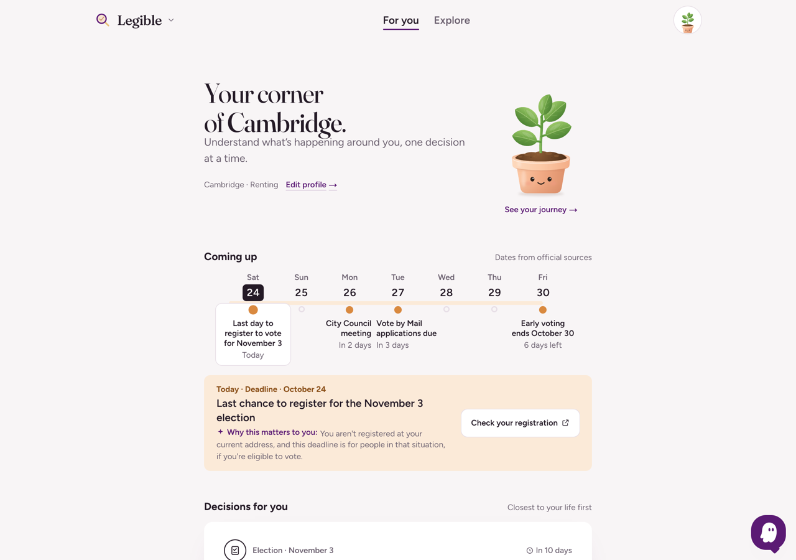
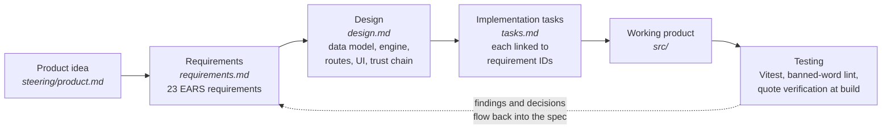
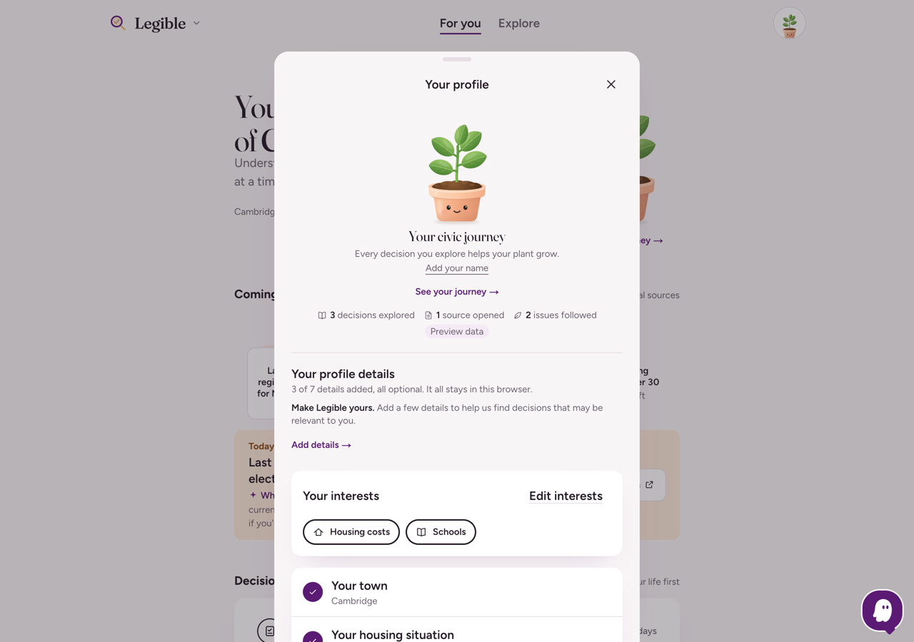
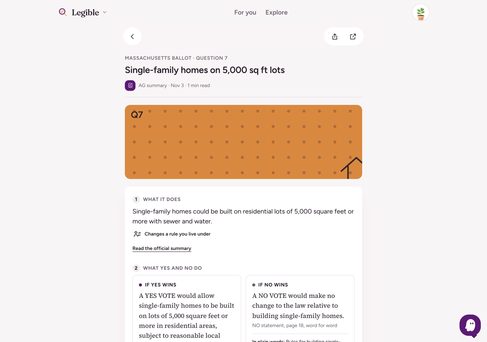
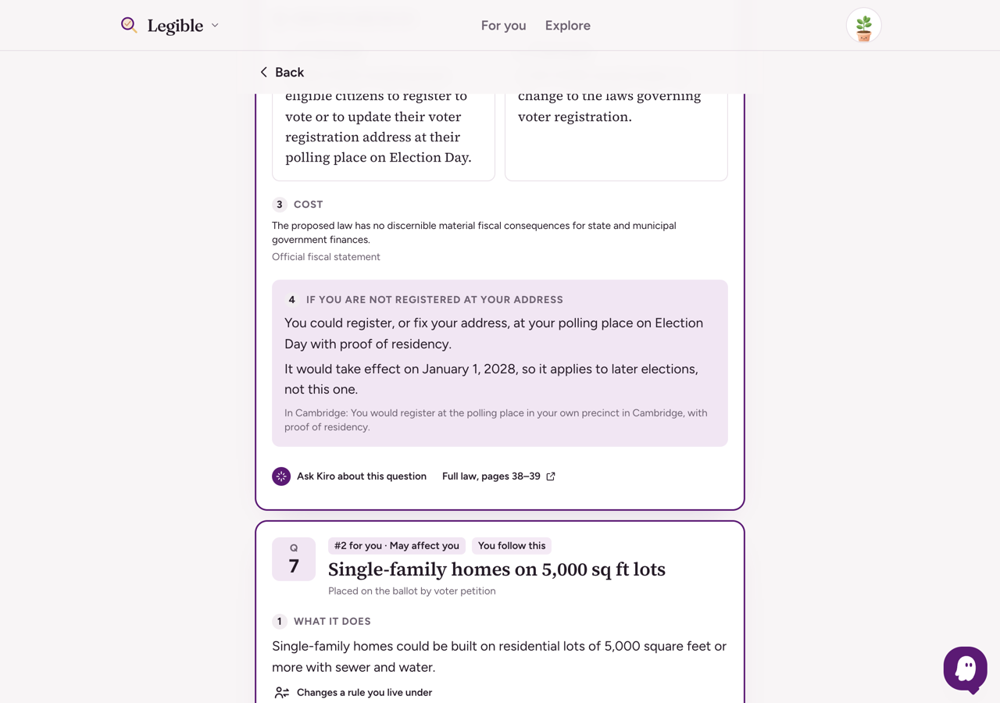
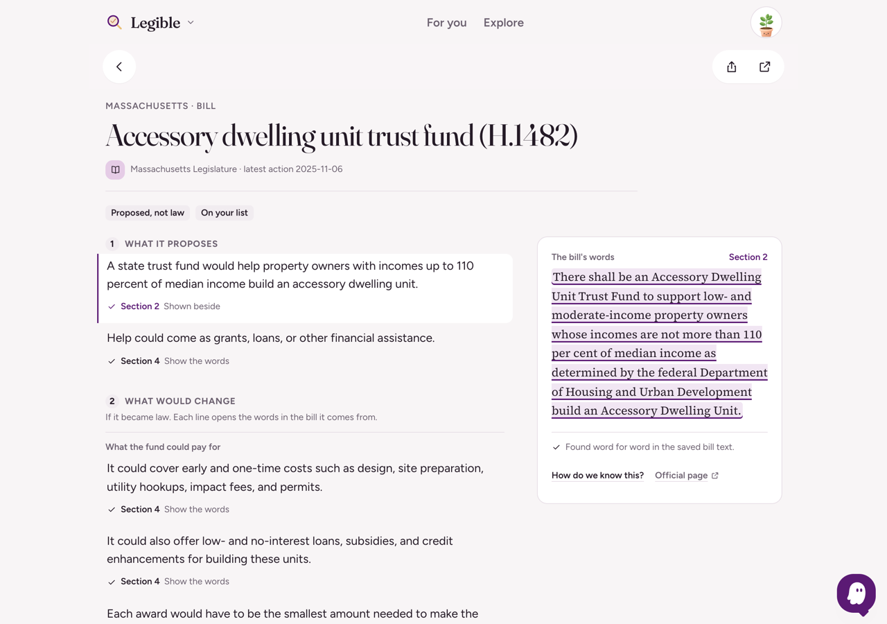
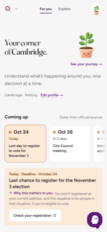
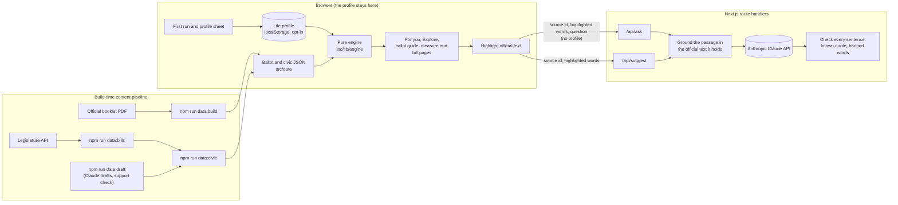

# Legible

**Local decisions, made legible to the people they are about.**

Legible shows a Massachusetts resident the public decisions being made around them and sorts them by where they meet that person's life. The first document is the 9 questions on the **November 3, 2026 Massachusetts ballot**, followed by election deadlines, public meetings, and state bills. You enter your town and, if you like, a few facts about your life. Legible then explains what each decision would change, quoting only the official text and checking every quote word for word. It never tells you how to vote.

Built at **Hackachusetts** (October 24, 2026, civic action track).

<p align="center">
  
</p>

---

## Built with Kiro

Legible was developed spec-first with [Kiro](https://kiro.dev). Everything in the app traces back to two folders:

| Folder | What it holds | Role |
|---|---|---|
| [`.kiro/steering/`](.kiro/steering/) | [`product.md`](.kiro/steering/product.md), [`tech.md`](.kiro/steering/tech.md), [`structure.md`](.kiro/steering/structure.md), [`development.md`](.kiro/steering/development.md) | Standing rules included in every session: the product's non-negotiable principles, the stack, where code lives, and how to set up, check, and change the code |
| [`.kiro/specs/legible/`](.kiro/specs/legible/) | [`requirements.md`](.kiro/specs/legible/requirements.md), [`design.md`](.kiro/specs/legible/design.md), [`tasks.md`](.kiro/specs/legible/tasks.md) | The feature spec: 23 requirements in EARS form, the technical design, and the implementation plan, with each task linked to the requirements it satisfies |

The spec is the source of truth for scope. It replaced the original draft in [`docs/spec.md`](docs/spec.md) on the morning of the event ([`docs/DECISIONS.md`](docs/DECISIONS.md), "Morning of Oct 24: scope reset"), and it has been updated alongside the code all day: **68 of the repository's 129 commits change a file under `.kiro/`**.

### The workflow



**1. Product idea → steering.** [`product.md`](.kiro/steering/product.md) fixes the principles every later step must respect: never recommend a vote; official text only, verified word for word; the profile never leaves the browser; a fixed neutral vocabulary of five directions; banned words in app-authored text.

**2. Requirements.** [`requirements.md`](.kiro/specs/legible/requirements.md) turns those principles into testable statements, for example:

> **10.1** THE SYSTEM SHALL never send life facts, topics, typed topic text, or the selected town to any server.
>
> **12.3** IF any quote in a measure is not found THEN THE SYSTEM SHALL hide that measure from the sorted view and list it under "Flagged, quote not found in source."

**3. Design.** [`design.md`](.kiro/specs/legible/design.md) answers how: the `Document`, `Measure`, `Quote`, and `Profile` types, the pure `buildCards` engine, the quote verifier, the ranking formula (`score = 0.65 × relevance + 0.35 × urgency`), the ask route's grounding rules, and the reliability chain from sentence to fingerprinted source.

**4. Implementation tasks.** [`tasks.md`](.kiro/specs/legible/tasks.md) breaks the design into checkable work. Each task names its requirements (`_Requirements: 1.5, 1.9_`) and is ticked when it lands. At the time of writing, 67 tasks are done and 46 remain open; stretch tasks are marked optional so they are cut first.

**5. Working product.** Code cites the spec it implements. The ask route, for example, opens with `Ask route (see .kiro/specs/legible/design.md, "Ask route" and "Chat dock")`.

**6. Testing.** The spec's rules are enforced by checks: 217 Vitest tests over the engine, profile, ranking, quote verification, and copy; `npm run lint:words` for banned words; and data builds that fail on any quote not found word for word in the official PDF.

---

## Case study: the Civic Profile

The Civic Profile is where a person tells Legible about their life. It is also where the product's privacy promise is easiest to break. Here is how one feature moves through the spec into the product.

<p align="center">
  
</p>

**Steering sets the constraint.** [`product.md`](.kiro/steering/product.md): *"The profile never leaves the browser. Only public documents, measure ids, and user questions about the official text may go to the server."*

**Requirements make it testable.**

| Requirement | What it demands |
|---|---|
| [1.4](.kiro/specs/legible/requirements.md#requirement-1-onboarding-and-life-profile) | A short first run; every life question optional; Skip records nothing; no sign-in, account, or name during onboarding |
| [1.8](.kiro/specs/legible/requirements.md#requirement-1-onboarding-and-life-profile) | An optional first name or nickname, stored only in the browser, used only to greet the person, never sent to a server, Supabase, or any third party; Clear my information removes it |
| [1.9](.kiro/specs/legible/requirements.md#requirement-1-onboarding-and-life-profile) | A personalization meter with every item weighted equally; Prefer not to say counts as done; sensitive facts never count |
| [10.4, 10.5](.kiro/specs/legible/requirements.md#requirement-10-privacy-the-user-can-see) | Nothing stored unless the person opts into Remember on this device; a Clear my information control with a confirm step |

**Design decides the shape.** [`design.md`](.kiro/specs/legible/design.md) lists every field Legible gathers, where it comes from, where it is stored, and what it is used for ("Information gathered"), and states what is never gathered: email, password, age, party, income, free text. It defines one storage key (`legible.profile.v1`), written only when Remember is on, and says why the name stays optional: a name next to "owns a firearm" makes a shared device more identifying.

**A real decision went through the spec.** A teammate's branch added Supabase email and password accounts with a name at sign-up. The team reviewed it against the steering rules in [`docs/accounts-review.md`](docs/accounts-review.md) and postponed accounts. The useful part, greeting a person by name, was kept and written down first: a design note (`00905ff`), then requirement 1.8 (`37991ff`), then the spec wording (`475ec97`). The result is an optional name that is local only and never asked during onboarding.

**Tasks track the build.** 16.0 profile schema → 16.4 meter logic → 16.5 avatar ring → 8.3 Clear my information → 16.8 profile navigation → 23.2 growth model → 23.4 Civic Profile → 23.5 Growth Story. Open work stays visible too: 23.7 (real growth tracking, data model to be agreed first) and 23.8 (production rollout).

**Code and tests follow the spec.**

| Spec | Code | Tests |
|---|---|---|
| Profile schema, storage, consent | [`src/lib/engine/profile.ts`](src/lib/engine/profile.ts) | [`profile.test.ts`](src/lib/engine/profile.test.ts) |
| Personalization meter | [`src/lib/engine/personalization.ts`](src/lib/engine/personalization.ts) | [`personalization.test.ts`](src/lib/engine/personalization.test.ts) |
| First run, Skip records nothing | [`src/lib/engine/onboarding.ts`](src/lib/engine/onboarding.ts) | [`onboarding.test.ts`](src/lib/engine/onboarding.test.ts) |
| Growth from exploring only, never from personal answers | [`src/lib/growth.ts`](src/lib/growth.ts) | [`growth.test.ts`](src/lib/growth.test.ts) |
| Profile sheet and editors | [`ProfileSheet.tsx`](src/components/ProfileSheet.tsx), [`profile-steps.tsx`](src/components/profile-steps.tsx) | checked in the browser at desktop and 375 px (task 16.8) |

> The plant companion and Growth Story (tasks 23.1–23.6) run in development builds only, behind `PLANT_ENABLED`. Production keeps the earlier avatar ring until task 23.8 is signed off. The growth totals shown are labeled preview data until task 23.7 lands.

---

## What Legible does

| | |
|---|---|
|  | **Every ballot question, in the state's words.** The official YES and NO statements are shown verbatim, side by side, with their page numbers. Legible's own lines are marked as its own, and each one opens the quote it rests on. |
|  | **Sorted by where it meets your life.** A renter who is not registered at their address sees what Election Day registration would change for them, and when. Facts decide "May affect you"; followed subjects decide "You follow this". The two never stand in for each other. |
|  | **Bills, annotated line by line.** Each sentence about a bill sits beside the bill's own words, found word for word in a fingerprinted copy saved from the Legislature's API. |
|  | **Phone first, and installable.** Every screen works at 375 px, and Legible can be added to an iPhone or Android home screen as a web app ([Requirement 16](.kiro/specs/legible/requirements.md#requirement-16-access-and-devices), task 24). There is no service worker, so it never shows old civic information from a cache. Dates are stated as facts ("In 3 days"), never as urgency. |

Screenshots come from a development build (`npm run dev`) with a sample profile: Cambridge, renting, not registered at the current address, following housing costs and schools.

---

## Architecture



- **Deterministic code does the trust work.** Sorting, ranking, the fixed vocabularies, quote verification, and the banned-word lint are plain TypeScript in `src/lib/engine`, `src/lib/verify`, `src/lib/explain`, and `src/lib/vocab`, with no React and no network, so they run in tests and in the browser.
- **The model drafts; code checks.** The two server routes call Anthropic's Claude API through `@anthropic-ai/sdk`. The ask route finds the highlighted words in the official text on the server, asks for one cited quote per sentence, and replaces any answer with an unknown quote or a banned word. Bill explainers drafted by `npm run data:draft` ship only lines that pass word-for-word verification and a separate support check.
- **"Ask Kiro"** is the name of Legible's in-app assistant. Its answers come from Anthropic's Claude (`claude-sonnet-5`); the build-time drafting script uses `claude-opus-5`. With no `ANTHROPIC_API_KEY` set, both routes answer 503 and the app falls back to rule-based questions and the official passage.
- **The profile never reaches the server.** The only exception is opt-in: in the ask dock a person may tick a matching phrase such as "you rent". That phrase is checked against Legible's own list, and the reply shows exactly what was sent.

Full detail: [`design.md`](.kiro/specs/legible/design.md) and [`structure.md`](.kiro/steering/structure.md).

---

## Development

Development is driven by the Kiro steering and specs. Open the repository in [Kiro](https://kiro.dev) and the four steering files are included in every session. The full setup, checks, working agreement, and content pipeline are in [`.kiro/steering/development.md`](.kiro/steering/development.md).

1. **Find the task.** Scope lives in [`.kiro/specs/legible/tasks.md`](.kiro/specs/legible/tasks.md) (and [`.kiro/specs/ballot-wrapped/`](.kiro/specs/ballot-wrapped/) for the share feature). If a change alters scope, update [`requirements.md`](.kiro/specs/legible/requirements.md) or [`design.md`](.kiro/specs/legible/design.md) first.
2. **Build within the steering rules.** [`product.md`](.kiro/steering/product.md) holds the principles the code must keep; [`structure.md`](.kiro/steering/structure.md) says where the code goes.
3. **Check.** Run the type check, lint, banned-word lint, tests, and build below.
4. **Close the loop.** Tick the task in `tasks.md` and commit.

### Getting started

Requirements: Node.js 20.9 or later (developed on Node 24) and npm.

```bash
npm install
cp .env.example .env.local   # add ANTHROPIC_API_KEY to enable Ask Kiro and bill drafts
npm run dev                  # http://localhost:3000
```

The app runs without an API key. Ask Kiro then shows the official passage and its source instead of an explanation.

| Command | What it does |
|---|---|
| `npm run dev` | Development server (Turbopack) |
| `npx tsc --noEmit` | Type check (run `npm run dev` or `npm run build` once first) |
| `npm run build` | Production build |
| `npm test` | Vitest: engine, profile, ranking, verification, copy |
| `npm run lint` | ESLint |
| `npm run lint:words` | Banned-word check over app strings and shipped data |
| `npm run data:build` | Rebuild `src/data/ballot-2026.json`; fails if any quote is not found word for word in the booklet |
| `npm run data:bills` | Save bill text, pinslip, and history from the Legislature API |
| `npm run data:civic` | Rebuild civic items and bill explainers; fails on any unverified quote |
| `npm run data:draft -- <bill>` | Draft a bill explainer with Claude, then verify and support-check it |

`ANTHROPIC_API_KEY` is server-only. Never give it a `NEXT_PUBLIC_` prefix.

---

## Repository map

```
.kiro/steering/           Product principles, tech stack, structure, development workflow (always included)
.kiro/specs/legible/      requirements.md, design.md, tasks.md: the source of truth for scope
.kiro/specs/ballot-wrapped/  Spec for the Ballot, Wrapped share feature
src/app/                  App Router: the single-page app, web app manifest, and the /api/ask and /api/suggest routes
src/components/           Screens and UI (For you, Explore, ballot guide, reader, profile sheet, plant)
src/lib/engine/           Pure personalization, ranking, and copy helpers
src/lib/verify/           Quote normalization and verification
src/lib/explain/          Bill explainer verification and support checks
src/lib/ask/              Grounding, prompt, and answer checks for Ask Kiro
src/lib/vocab/            Directions, life facts, topics, banned words
src/data/                 Shipped ballot and civic data, towns list
scripts/                  Content builds and hand-written content
data/                     Official sources, drafts, and reviews (not shipped)
docs/                     Original spec, decisions log, accounts review, screenshots
```

## Principles

From [`.kiro/steering/product.md`](.kiro/steering/product.md):

- **Never tell anyone how to vote.** No recommendations, scores, party framing, or "people like you" comparisons.
- **Official text only.** YES and NO text is verbatim. Every generated sentence links to a quote, and every quote is verified word for word.
- **The profile never leaves the browser.**
- **Fixed neutral vocabulary.** Five directions only: expands, restricts, rule_change, who_decides, none.
- **Say what was reviewed.** Reviewed content, machine-verified content, and AI drafts are labeled differently.

## Team

Built at Hackachusetts 2026. Contributors are listed in the commit history.
